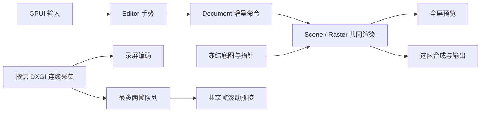

# RaiShot 0.4

[English](README.md) · [更新记录](CHANGELOG.md) · [参与贡献](CONTRIBUTING.md) · [安全报告](SECURITY.md) · [第三方通知](THIRD_PARTY_NOTICES.md)

Windows 区域截图、标注、贴图、OCR、长截图与录屏工具，Rust + GPUI 实现，不依赖 .NET 或 WebView 运行时。使用方法与快捷键见下文；源码构建与贡献方式见[参与贡献](CONTRIBUTING.md)。内部代号 `rustshot`（crate、模块、`RUSTSHOT_*` 环境变量、窗口类名）固定不变；产品名与 EXE 名只在 `src/brand.rs`、`Cargo.toml` 的 `[[bin]]`、`build.rs` 和 `Tools/package.ps1` 中定义。

自有代码采用 [MIT 开源许可证](LICENSE)，允许商用、修改、再分发、再许可及闭源衍生使用；分发软件副本或实质性部分时须保留版权和许可声明。许可范围见[许可说明](docs/license.md)。此前已合法授出的版本权利不变；第三方代码、模型、运行库、字体及其他资源保留各自许可证。

## 使用

解压便携包后运行 `raishot.exe`；从源码构建见[参与贡献](CONTRIBUTING.md)。新配置默认 **Ctrl+1** 开始截图、**Ctrl+2** 将剪贴板图片或文本打开为贴图；左键托盘开始截图，右键提供截图、文件 / 剪贴板贴图、关闭恢复、贴图管理、历史、设置、说明和退出。已有截图预设、自定义或禁用配置保留；旧截图键若已使用 Ctrl+2，新增贴图键默认禁用以保留原绑定。三个 EXE 保持同目录和原文件名。

设置采用左侧分类、右侧当前分类选项，分为常规、截图、贴图、快捷键、保存、工具栏。两项全局快捷键均可选择默认、禁用或录制自定义组合；截图还保留 Ctrl+Alt+Shift+S、Ctrl+Alt+A、PrintScreen 预设。录制时 Esc 取消、Backspace 禁用，失焦、切换分类或关窗取消录制；冲突时保留原热键并提示。普通设置即时保存，保存规则点击“应用”后生效，切换分类保留未应用草稿。

绘制画布覆盖整个虚拟桌面，选区仅控制遮罩与输出裁剪。建立范围后可以在选区外标注，移动、缩放、重选和切屏都保留标注。绿色控制点编辑选区，蓝色控制点编辑对象。工具栏锚定手势结束所在屏幕，主栏和属性栏分开浮动：主栏保留常用绘制工具、撤销重做与输出；属性栏显示当前工具或选中对象的参数，选区工具显示圆角、阴影和边框，空对象编辑时隐藏。线宽、字号、圆角、透明度和效果强度点击后选择，不同时铺开所有档位。“更多”使用独立的工具/操作面板，选择后关闭；Esc 或点击画布空白处可收起，收起点击不创建标注。拖动主栏手柄联动两个栏的位置，展开面板和悬停提示不挪动主栏。浅色/深色在更多操作中切换。工具与操作按钮使用统一的圆角 SVG 图标，随 EXE 内嵌并适配显示缩放；托盘使用由矢量源生成的多尺寸透明图标。

设置中的“截图 / 贴图工具栏”可勾选绘制工具显示或隐藏，用上下按钮重排，也可恢复默认。默认顺序为矩形、箭头、铅笔、文字、椭圆、马赛克；截图和贴图共用同一配置，新的截图会话及重新展开的贴图栏应用设置。隐藏工具只移出一级栏，仍可从“更多工具”选择；选区或移动、对象编辑、更多、撤销重做及输出保留固定入口。工具较多时一级栏按可用宽度换行，二级属性继续跟随当前工具；已有工具快捷键不随排序改变。

| 能力 | 当前可用内容 |
| --- | --- |
| 选区 | 所有活动屏幕、跨屏框选、当前/全部屏切换、移动/八向缩放、窗口吸附、放大镜、HEX 取色、辅助线、包含开始截图时的鼠标指针 |
| 选区外观 | 经典强度/阴影边框互斥；圆角、三档阴影、内外边框、颜色与记忆保留，独立浓度/扩散/厚度及双效果位于折叠增强区，输出保留透明边缘 |
| 标注 | 矩形、椭圆、直线、单向/双向线形箭头、实心单向/双向箭头、尖尾箭头（均可弯曲）、画笔、可编辑折线、荧光笔、高亮框、文字、水印、序号、聚光灯 |
| 属性 | 预设/自定义颜色、线宽、填充、圆角、透明度、虚线、字号和粗体；各工具分别记住跨会话参数 |
| 效果 | 矩形马赛克、矩形模糊、打码笔、模糊笔、恢复原图的局部橡皮擦；效果采样底图和下层标注 |
| 套索 | 手绘闭合轮廓、草稿确认/取消、透明边缘与紧裁剪；PNG/剪贴板保留 alpha，清除及应用可撤销 |
| 编辑 | 选中、移动、缩放、旋转、Ctrl 点击多选、框选多对象、组合/拆分、组合比例缩放与旋转、批量改属性/删除、复制对象、置顶层/置底层、对象橡皮擦、128 条增量撤销/重做 |
| 文字 | 中文 IME、粘贴、换行、文本选择与光标；字体、粗体/斜体/下划线/删除线、对齐、描边、背景与透明度；F2/双击编辑，Enter/Ctrl+Enter 完成，Shift+Enter 换行，Esc 保留正文并结束编辑；水印平铺 |
| 输出 | 剪贴板；截图/贴图/图片编辑/长截图共用保存面板，PNG/JPG/JPEG/BMP、PNG 压缩、JPEG 质量、文件名模板、最近目录；快速保存自动编号，覆盖须确认 |
| 贴图 | 鼠标锚点缩放、透明度、缩略收纳、置顶 / 锁定 / 穿透、旋转翻转与颜色处理、处理撤销、OCR 选字 / 二维码 / 取色、批注和裁剪副本、文件 / 剪贴板贴图、关闭恢复与托盘管理 |
| 识别 | Windows 本机 OCR、纯 Rust 二维码识别、识别文字区域后统一打码；结果可复制 |
| 长截图 | 一级固定入口；手动/自动滚动、方向与节奏；持续选区采集、纵横双向拼接、回访去重、固定边带、暂停/单次/撤销；编辑/返回、四边裁剪与删中段、复制/保存/贴图/标注 |
| 录屏 | 主工具栏录屏按钮 / G；传输工具栏含计时与开始延迟、5–60 FPS、高清 MP4 / 压缩 MP4 / GIF 预设、系统声与麦克风、按键/点击显示、暂停；系统 Media Foundation 边录边码，停止后框内预览、转 GIF、保存、复制文件、录屏历史、重录 |
| 常驻 | 原生托盘、预设/自定义热键及禁用、共享绘制工具栏显示/隐藏与排序、Explorer 重启恢复、自有进程回收、主题/辅助功能/保存规则设置、本机历史 |

Ctrl+S 打开保存面板，显示合成图缩略预览、尺寸和实际编码大小。PNG 保留透明，压缩档位只影响大小与速度；JPEG 质量可调，JPEG/BMP 将透明区域合成白底。命名模板支持 `{date}`、`{date:yyyy_MM_dd_HH_mm_ss}`、`{time}`、`{width}`、`{height}`，日期有六种预设。手改文件名后模板调整保留当前名称，最终扩展名服从所选格式。普通保存记住最近 12 个目录；“记住本次设置”成功后更新快速保存的目录与规则，取消或失败不更新。设置页提供独立草稿，点击应用后生效。

Ctrl+Shift+S 快速保存，贴图右键也有入口。同名文件自动追加编号，原子提交避免并发覆盖；普通保存遇到重名可明确覆盖或保留两个文件。图片编辑始终保护原始文件。编码在后台串行处理，连续调质量只保留最新需求，确认后复用编码字节；缩略预览有大小上限。保存成功才进入已开启的截图历史，失败保留编辑会话。

文字的显示、换行、光标和鼠标命中共用 Uniscribe 字形布局，支持 Unicode 字符簇与字体回退；当前按整个文本对象设置格式，局部文字格式尚未实现。局部橡皮擦恢复笔迹覆盖的原始底图，保留下层标注并可撤销；对象橡皮擦删除整个命中对象。各工具参数在输出或关闭会话时保存，新截图、图片编辑和贴图标注恢复各自工具的颜色、粗细、文字及箭头样式；滚轮调整只改内存。字体按名称保存，未知或损坏配置回退有效默认值，不保存文字正文。没有自动创建开机启动项。

选区工具的第二栏提供圆角、阴影、边框开关，“外观参数”调整具体档位及自定义颜色；Ctrl+滚轮精调，Shift+滚轮快调。圆角开关和最后参数自动保留，“记住阴影和边框开关”控制下次截图是否继续启用这两项。阴影与外边框扩展透明输出尺寸，贴图原点同步补偿，标注与截图范围仍使用原来的全屏坐标。套索绕过外观，OCR 使用未装饰的原始裁剪；打开图片及贴图不会重复应用已导出的外观。参数在输出或关闭时保存，预览缓存四条边带与小圆角，不因悬停或普通绘制重复生成整屏位图。

套索独立于矩形选区和标注对象：抬起显示金色虚线草稿，应用后显示绿色轮廓，边界外透明并按轮廓包围盒输出。轮廓采用非零环绕，重复绕圈仍保留内部，反向内圈形成孔洞。重选或调整矩形范围会清除套索及其历史，保留所有标注与对象历史；取消重选仍保留原套索。套索只用于静态截图，长截图和录屏需先清除。复制同时提供 PNG、带 alpha 的 DIBV5 和白底旧式 DIB；其它应用是否保留透明度由其选择的剪贴板格式决定。JPG/BMP、OCR 和二维码识别使用白底合成，避免透明边缘变黑。

## 快捷键与交互

| 键位 | 操作 |
| --- | --- |
| 1–9 | 截图按当前可见工具槽位选择；贴图工具栏显示时按可见工具顺序选择，随显隐和排序设置变化 |
| 0 / V | 截图 0 在选区与对象编辑之间切换，V 进入对象编辑；贴图工具栏显示时两键均进入对象编辑 |
| M / H / N / X | 马赛克 / 荧光笔 / 序号 / 文字；贴图工具栏显示时使用绘制工具键 |
| B / P / E / Shift+E / S / O | 模糊 / 折线 / 局部橡皮擦 / 对象橡皮擦 / 聚光灯 / 套索 |
| Shift 拖拽 | 方形选区、正方形/正圆；箭头及折线 45°；角点缩放保持原比例 |
| Shift 按下后画铅笔 | 直线模式，方向按 22.5° 吸附；松开 Shift 保持直线，绘制中途按 Shift 保持原来的自由笔迹 |
| 画布滚轮 | 形状/画笔线宽、橡皮擦直径、文字/序号字号、马赛克/模糊强度、聚光灯暗度/高亮矩形透明度 |
| Shift+滚轮（矩形/聚光灯） | 孔或矩形圆角增减 1 px |
| Ctrl+滚轮（聚光灯） | 共享边框线宽增减 1 px，0 关闭边框 |
| Ctrl+滚轮（马赛克/模糊画笔） | 调整效果强度；普通滚轮调整画笔直径 |
| 悬停属性值后滚轮 | 精细调整线宽、字号、圆角、透明度或效果强度 |
| 选区内 / 边缘滚轮 | 四边同时扩缩 / 对应边缘增减 1 物理像素 |
| 箭头单击起点，再单击终点 | 创建箭头；第二次按下可继续拖动，Esc / 右键取消草稿 |
| 箭头样式面板 | 真实矢量预览：直线、单/双线形、单/双实心、尖尾；已有曲线直接切换，可撤销 |
| 拖箭头橙色中点 | 弯曲；拖端点保持弯曲比例；中点靠近直线自动吸附 |
| 右键箭头中点 / 属性栏“拉直” | 拉直曲线，可撤销 |
| 拖折线顶点 / 双击线段 | 调整顶点 / 插入节点 |
| Backspace / 属性栏“删顶点” | 绘制时退回最近固定点；选中顶点时删除该点（至少保留两点） |
| 双击、Enter 或右键（折线中） | 完成折线；Enter / 右键不提交鼠标跟随的临时尾段 |
| 折线属性“平滑曲线”“闭合填充” | 保留顶点并切换曲线、闭合填充，可撤销 |
| F2 或双击文字 / Enter、Ctrl+Enter | 重新编辑 / 完成文字；Shift+Enter、Ctrl+Shift+Enter 换行，Esc 保留正文并结束编辑；空白旧文字结束后删除，可撤销 |
| Ctrl 点击 / 空白处拖框 | 多选对象 / 框选对象（编辑工具中） |
| 方向键 / Shift+方向键 | 移动对象或选区 1 / 10 物理像素 |
| Alt+方向键 | 选区工具下微调截图范围大小 |
| Ctrl+D / Ctrl+] / Ctrl+[ | 复制对象 / 置顶层 / 置底层 |
| Ctrl+G / Ctrl+Shift+G | 组合 / 拆分；点击任一组合成员选中整组 |
| 拖白色旋转手柄 / Shift 拖手柄 | 旋转对象或选中多对象 / 按 15° 吸附 |
| Alt+[ / Alt+] / 属性栏“归零” | 左转 / 右转 15° / 各对象角度归零 |
| Delete / Shift+Delete | 删除选中对象 / 清空标注 |
| Ctrl+Z / Ctrl+Y / Ctrl+Shift+Z | 撤销 / 重做 |
| A / Alt+A / Ctrl+Shift+A / Ctrl+A | 框选前A左移指针，有选区裸A保留；Alt+A当前指针所在物理屏，Ctrl+Shift+A全虚拟桌面；Ctrl+A按上下文固定预览／全选对象或文字，绘制模式提示V切换编辑再全选 |
| Alt / C（框选前） / 反引号 | 临时辅助线 / 复制光标处颜色（放大镜开启时按当前RGB或HEX格式，否则HEX） / 鼠标指针开关 |
| T 或中键 / R / G / L | 贴图 / OCR / 录屏 / 长截图 |
| 套索抬起 / Enter / Esc 或右键 | 闭合为草稿 / 应用轮廓 / 取消草稿；没有草稿时退出套索工具，保留已应用轮廓 |
| Enter / Ctrl+C / Ctrl+S / Ctrl+Shift+S | 复制完成 / 复制完成 / 保存 / 快速保存；套索草稿的第一次 Enter 只应用，第二次完成 |
| 右键 / Esc | 重选；固定屏幕预览右键恢复自动选区，普通无范围时退出 / 取消手势，闲置时退出 |

Ctrl+A 的固定预览保持选区内部无遮罩。单击预览确认选区，拖动或在外部按下重新框选；走远再拖回原点仍按拖动处理。Enter 按确认偏好输出，中键可在固定范围外贴图；输出使用当前范围实际呈现后的图像。连续按键在所在显示器（含任务栏）与整个冻结虚拟桌面之间切换，文字输入和对象全选优先。

滚轮向上增大、向下减小；高分辨率滚轮累积完整刻度，按 Windows 滚动行数还原，Shift 的水平事件也能处理。连续滚动在 450 ms 内合并成一次撤销，触及上下限不新增记录。绘制或移动过程中滚轮修改保留在当前手势，抬起只提交一次。菜单打开时和工具栏空白处滚动不会改动画布。组合缩放产生超出普通绘制档位的参数时，滚轮向外保持当前值，反向按原步长回调，不突然跳到上限或下限。

点击矩形、聚光灯或高亮框的“圆角”可输入 0–50 物理像素或拖动滑条；聚光灯“边框”线宽为 0–20，“暗度”为 0–100%。参数窗内可用滚轮修改草稿，Enter/确认应用，Esc/取消关闭；快选直接应用一次。选中对象的四个金色菱形都调整该对象的统一圆角，随旋转/缩放保持可命中，单次拖动可撤销，取消保留重做；小对象无法与缩放节点避让时隐藏。圆角只影响当前孔，边框色、线宽与暗度联动所有孔；几何缩放不改变共享边框线宽。

数值/滑条草稿已扩展到普通线宽、画笔/橡皮擦直径、文字/序号字号和效果强度，范围按工具区分；马赛克和模糊强度为 2–64 的整数。越出滑条或参数窗的移动/抬键由本窗口捕获收尾，输入数字不再切换绘图工具或旋转贴图。此前参数/主选的独立核心、Debug 截图及 Release 贴图专项通过；不替代本轮高亮框圆角验证，混合 DPI、真实 IME 和前台焦点仍未验。

铅笔默认使用保角矢量路径：原始采样保留，先固定明显转角、首尾，再按弧长做法向降噪、受原始轨迹约束的简化和切线连续的贝塞尔拟合。相距很近的明确折角独立保护，2 px 台阶或窄回折也保留两个顶点；与整体弯曲方向相反的局部噪声不锁为硬折点。尖角还需得到相邻 2 px 轨迹的方向支持，避免小圆弧上的单像素台阶突然变成硬折角。各环节使用固定物理像素预算，不因线宽增大而抹平更多细节；收笔不会另做一次润色。属性栏可以切到「原始笔迹」，已有对象的模式切换可撤销。基础形状、笔迹、箭头与折线保留贝塞尔几何；描边/填充先做矢量并集，透明交叉处只叠加一次。GPUI 预览按设备像素计算连续的解析边缘覆盖，显示比例变化不拉伸标注位图；命中、导出与下层效果采样使用同一曲线的自适应细分。

快速绘制时，自由铅笔会读取 Windows 鼠标移动历史，按时间和本次笔画的边界补回消息合并期间的采样；历史缺失时使用当前事件位置。补点沿用物理像素坐标并去除连续重复位置，每批输入只请求一次重绘。若未收到抬键消息，后续不再按住左键的移动会结束上一笔，避免悬停或下一笔被连成一条长线。

选中对象后，第二条属性栏增加角度、组合/拆分、左右旋转和归零。多选时显示组合操作及数量，不铺开单一工具的全部属性；主工具栏不因选择变化移动。绘制与对象编辑期间两条工具栏保持显示，不在按下 / 抬起时反复隐藏；仅调整截图范围时暂时收起，普通抬笔不改变工具栏的屏幕锚点。组合保留各成员的原始对象、层次和样式，可统一移动、比例缩放、旋转、复制、删除；一组复制品使用独立组号。当前支持单层组合，编辑单个成员的节点或文字前可拆分；尚未支持嵌套组合及跨会话恢复。比例缩放同步普通对象线宽、圆角与文字字号，并以虚拟画布为最大范围；聚光灯只缩放孔及圆角，共享边框宽度保持不变。

选择变化后的参数基准已修复：Ctrl 切换、全选、框选、组合与复制同步主选样式，进入选择模式前保存原绘制工具预设；全选清除旧选择的滚轮余量，避免下一对象继承未满刻度。核心选择测试与 GPUI Ctrl+A dispatch 配合原生滚轮的专项通过，后者未模拟物理 Ctrl+A。

旋转以单独角度保存，原始铅笔点不会反复烘焙或重采样。轮廓、命中、控制点、文字光标及效果遮罩使用同一变换；旋转后仍可编辑节点、拉直箭头、调整形状和文字。一次旋转或组合手势只占一条撤销，取消保留重做。聚光灯所有圆角孔先做并集，再直接绘制一层矢量暗面与并集边框，旋转不生成整屏蒙版；导出沿同一边界只计算请求区域的覆盖率。文字逆向采样先合成 alpha，避免斜边出现黑边。

控制点显示对应方向光标，拖动对象显示移动光标；画笔和橡皮擦显示实际直径。重叠控制点选最近的一点，小于 4 px 的对象移动不会跳动；新形状至少 4 px，单击画笔仍可画点。椭圆及序号按真实几何命中，预览线段补齐圆头与连接。已有文字增大字号时同步调整文本框高度，避免截断。

点击窗口范围可快速框选该窗口，拖动仍可自由选择。文字模式会消费文本输入，字母快捷键此时不会切换工具。切换工具提交文字；普通文字的 Esc 保留正文并结束编辑，新空白草稿不写入历史，旧文字编辑为空白后删除一次。输入法组合期间先由输入法确认或取消，工具切换与输出不会提交预编辑内容；撤销、重做及清空是显式回滚入口。

普通文字、单行字段与 OCR 全文按完整字素移动、选字和删除；普通标注空选择 Ctrl+C/X 保留剪贴板。输入法仍使用原生码点范围。截图和贴图的工具／窗口字母仅接受对应的修饰组合，快捷键详见上表。

复制或保存后截图会话结束；取消保存返回编辑。贴图与采集面板接管自己的窗口，冻结桌面和截图文档随原截图窗口释放，托盘可再次发起截图。贴图窗口使用独立图片状态；空格呼出一级工具栏，二级属性栏根据工具和选中对象独立显示，可直接在贴图上绘制，右键打开完整菜单。

贴图一级栏分为绘制工具、撤销重做、输出三组，绘制工具的显示和顺序与截图共用设置；「更多工具」可选择隐藏工具及折线、荧光笔、水印、序号、模糊、橡皮擦等，选完后由二级栏显示对应参数。「移动」收起绘制参数栏；再次选择工具即恢复二级栏。两栏按整组空间决定放在图片上方或下方，一级靠近图片，二级向外展开；切换工具、绘制及调整参数保持一级位置。

| 贴图操作 | 使用方式 |
|---|---|
| 移动 / 缩放 | 拖动移动，四角等比缩放；方向键微移，Shift 加速；滚轮以鼠标为锚点缩放，标注时用 Alt+滚轮缩放 |
| 空格悬浮栏 | 空格显示 / 收起，长按不连闪；一级放工具、撤销重做与输出，二级独立显示字体、字号、填充、圆角、透明度、线型、箭头端点及效果参数；支持悬停滚轮，独立参数窗不挪动一级；移动工具可在栏显示时拖动窗口 |
| 标注键盘 | 栏显示时 2/3/4/7、V/M/B/H/X 等选择工具，工具栏获得焦点也有效；Esc 先取消进行中的草稿或关闭参数面板，再收起栏；换工具和无变化点击保留重做 |
| 文件拖拽 | Ctrl+左键拖出带标注的 PNG 到支持文件拖放的应用；拖入图片文件新建贴图，单批最多 8 张 |
| 尺寸 / 缩略收纳 | 中键或 0 恢复 100%；F 适应当前屏幕；Tab 或双击切换缩略图，展开恢复原比例 |
| 透明度 / 置顶 / 锁定 | Ctrl+滚轮调整透明度，菜单可精确选择；T 置顶；L 同时锁定移动、缩放与图像编辑 |
| 关闭 / 阴影 / 标注显隐 | Esc 或 Ctrl+W 关闭；Y 切换窗口阴影；栏收起时 H 显示 / 隐藏标注 |
| 穿透 / 隐藏 | Ctrl+T 开启鼠标穿透，透明度最高 60%；托盘「贴图管理」可显示、隐藏、恢复交互、关闭全部贴图 |
| 图像处理 | 栏收起时 1 / 2 右转 / 左转，3 / 4 翻转，5 灰度，6 反色，7 / 8 亮度；栏显示时仍可从右键菜单处理；0 重置，Ctrl+Z / Y 撤销 / 重做，保留处理前的有效标注草稿 |
| 复制 / 保存 / 多副本 | Ctrl+C 复制当前图像或选中文字；Ctrl+S 保存；栏收起时 Ctrl+D 再贴一张，标注时复制对象。菜单和操作栏不会导出 |
| 标注 / 裁剪 | 右键「编辑 / 标注副本」或「裁剪副本」打开同一个 GPUI 编辑器，可再复制、保存或贴图 |
| 文字 / 二维码 / 取色 | E 按需启动本机 OCR 并拖选文字，Ctrl+C 复制选字，Ctrl+A 全选；O 重新识别，Ctrl+Shift+C 复制全文，Ctrl+Alt+C 段落复制选字，Ctrl+F 查找（F3 / Shift+F3 跳转）；右键识别二维码或拾取颜色 |
| 文件 / 剪贴板 / 恢复 | 托盘提供图片文件和剪贴板图片 / 纯文本贴图；「恢复最近关闭的贴图」可连续恢复 |

关闭恢复记录与截图历史分开，默认保留最近 20 张、128 MiB、7 天，可在设置中关闭，也可从托盘清空。记录只在本机 `%LocalAppData%/RaiShot/closed-pins` 保存原图及处理、位置、比例和透明度；恢复时关闭鼠标穿透，缺失显示器时保证窗口可找回。恢复读取使用系统文件锁，异常退出不会消耗记录。

贴图缩放复用已有预览，多副本共享原图；旋转和颜色处理在后台执行，处理撤销记录参数。标注复用截图的 Editor / Scene 与矢量画布，收起工具栏后对象仍可继续编辑；需要整体处理时保存有界文档检查点，使处理与标注可连续撤销。普通贴图不启动 OCR，也不保留冻结桌面。分组与标题已有工作区入口；HTML / 公式渲染、实时窗口贴图、翻译和抠图仍是后续项目，编辑副本目前基于成品图重新标注。

长截图先框选目标内容，点击一级栏长截图图标或按 L。面板持续采集选区，在目标应用中手动滚动即可拼接；也可点击“自动滚动”，按已绑定的原目标逐步驱动，停止自动后仍可手动采集。保持至少一半重叠，支持纵向/横向、向前/向后补充和回访去重。面板可暂停/继续、单次采集、撤销与重来。固定页眉/页脚或左右栏可以自动检测，也可填写两端像素；遇到平坦或重复内容提示手动设置，保留成功结果。切换方向从当前页面重来，边带草稿在重新开始时应用；无移动、遮挡或动态内容无法可靠匹配时暂停自动驱动，不盲发下一笔滚轮。应用适配、选区拖动调整和复杂动态容错仍待补。

“调整长图”先等待暂停完成，再打开共享原始条带的编辑窗口。拖动/滚轮浏览、Ctrl+滚轮按指针缩放，100% 对应原图物理像素。裁剪支持四边把手和框内移动，Shift 可重新画选区；删除中段沿拼接轴选范围，Enter 应用，Esc 取消。裁剪、删段、还原均可撤销/重做，返回采集保留原始长图。只有复制、保存、贴图或进入标注时才生成完整成品；编辑预览限制 1600×1200。成品限制 3200 万像素和 65535 单边；超过纹理单边限制的图片分块显示，长贴图初始适合屏幕，保存后的长图仍可重新打开。

录屏不再依赖外部 FFmpeg：视频由系统 Media Foundation 的 H.264 编码器写 MP4（有硬件编码器时自动使用，否则回退微软软件编码器），音频为 AAC。Windows N 版需先安装“媒体功能包”。框选后点主工具栏的录屏按钮或按 G，选区窗口隐藏，原位置显示蓝色录屏框和排除采集的传输工具栏；待录时可拖动八个缩放柄调整范围。

传输工具栏从左到右为：拖动把手、计时（点击设置 0/1/2/3/5/10 秒开始延迟）、帧率（5/16/24/30/60，默认 30）、预设（高清 MP4、压缩 MP4、GIF）、录制/停止按钮、音频（麦克风、系统声，GIF 不带音轨）、录屏显示（按键、鼠标点击与滚轮、过滤打字键、鼠标指针）、暂停和关闭。快捷键：F9 开始/停止，F10 或空格暂停/继续，Esc 待录时关闭、录制中停止。录制中边框变红，暂停变橙；暂停期间不采集、不计时，成片时长等于实际录制时长。系统声通过默认输出设备环回采集，同时在该设备播放静音流保持时间轴连续；设备缺失时提示并继续无声录制。按键与点击效果由录制线程直接合成进视频帧，标准密码框内不显示按键内容。

停止后不关闭录屏框，而是在原选区内自动播放成片；预览工具栏提供进度条、播放/暂停、播放速度、分辨率与“格式 · 画质 · 大小”信息、转为 GIF、保存（另存为）、复制文件（CF_HDROP，可直接粘贴到聊天或文件夹）、打开录屏历史、重新录制（删除本次文件）和完成。成品先写入 `%LOCALAPPDATA%/RaiShot/recordings`，“完成”或关闭会保留文件；GIF 预设先录高清 MP4 再转码，相同帧合并为延时，变化帧只编码差异区域，长边超过 1280 像素时等比缩小，中间 MP4 随会话结束删除。奇数选区边向下取偶。工具栏、倒计时、边框和缩放柄都设置系统采集排除；无法排除时拒绝开始，避免把控件录进视频。

历史默认关闭，开启后仅保存完成的合成图片，最多 50 张、256 MiB、30 天，在保存或打开历史时清理；不保留编辑对象。历史列表先读元数据，点击一项才解码并打开贴图。设置与历史在 `%LocalAppData%/RaiShot`，快速保存默认 `%UserProfile%/Pictures/RaiShot`。设置变更对新截图生效；热键立即通知托盘重新注册。

## 开发文档

[docs/](docs/README.md) 是完整项目开发上下文的统一入口，包含术语、构建与协作方式、架构、行为清单、当前状态、路线、技术专题、研究结论和设计原型。贡献者和 agent 均可直接从公开仓库继续开发，无需维护者私有资料。

## 架构

| 边界 | 模块与职责 |
| --- | --- |
| 常驻平台 | `ui`/`tray`：原生消息循环、热键、菜单及自有工作进程；WindowProc 只投递消息 |
| 截图平台 | `fast_capture`/`capture`/`desktop`/`gpui_capture`：静态桌面 GDI 冻结、DXGI 回退、多屏坐标、并行准备与窗口生命周期；原始像素和 GPUI 预览共享 Arc |
| 几何与文档 | `annotation`：工具能力、样式和几何；`document`：稳定 ID、图层、增量命令与撤销；`editor`：手势与编辑事务 |
| 共同渲染 | `scene`/`vector_path`/`vector_mesh`：共享曲线、填充与矢量并集网格；`spotlight`：圆角孔并集、共享暗层/边框及局部导出覆盖率；`vector_paint`：GPUI 解析抗锯齿；`raster`：导出覆盖率及像素效果 |
| GPUI 接入 | `capture_view`/`capture_canvas`：输入与视图；`capture_toolbar`/`capture_properties`/`toolbar_icons`：主栏、上下文属性栏与内嵌 SVG；`parameter_control`：截图/贴图共用数值草稿与确认；`text_input`/`text_geometry`：UTF-16 范围、中文 IME、选择与光标 |
| 工具栏布局 | `toolbar_layout`：逻辑坐标中的双栏锚点、窄屏换行、屏幕边缘约束和临时面板状态；布局不依赖 GPUI |
| 贴图 | `pin_model` 纯状态与处理历史；`pin_view` 宿主；`pin_interaction` 物理坐标手势；`pin_annotation` 复用文档与处理边界；`pin_toolbar` / `pin_property_bar` 两级栏、`pin_tool_picker` 临时工具菜单、`pin_toolbar_layout` 整组布局；`pin_menu` 右键菜单；`pin_drag` / `pin_drop` 原生文件拖放；`pin_native` HWND 操作；`pin_store` 有界关闭恢复；`pin_app` 文件 / 剪贴板 / 恢复入口 |
| 独立工作流 | `recognition`、`recording`/`recording_view`；`stitch`/`stitch_match` 拼接，`long_capture_pipeline` 管理独立DXGI、两帧队列及尾帧屏障；`long_capture_runtime` 管理匹配消费与版本，`long_document` 共享条带编辑，`long_capture_view`/`long_editor` 处理界面 |
| 可重用采集 | `live_capture`：按需保留 DXGI duplication，只读指定区域；普通冻结截图不持有连续采集器 |
| 本机数据 | `export`、`preferences`、`history`：图片输出、明确 INI 字段名、有界图片历史 |
| 验收 | 按改动选定向测试；`vector_aa_smoke` 只检查绘制/缩放，`gpui_smoke` 验证完整交互，`long_smoke` 验证拼接，`raishot-cli --pin-smoke` 验证贴图（`RUSTSHOT_PIN_SMOKE_CASE=state` 仅运行状态与恢复，`interaction` 仅运行移动 / 悬浮栏 / 贴图内标注 / 文件拖放专项）；合成像素不上传，不改写用户剪贴板 |

模型与文档不创建 UI 或 GPU。手势结束提交一条命令，取消和无变化操作不污染历史；多选操作是一个批量命令，撤销不保存全屏位图。未变化的下层复用缓存，修改下层使其后的效果失效；切换指针底图也使缓存失效。马赛克按全屏原点对齐，效果采样下层，导出裁剪不会改变颗粒。矩形、圆角矩形、椭圆、铅笔、箭头、折线、填充和透明高亮都保持矢量几何；透明度与虚线不再触发标注位图回退。文字与模糊等像素效果仍生成局部图像。

待机不初始化 GPUI、应用侧显式 D3D 设备或 OCR；DWM 的系统合成表面可能使用 GPU，尚未测量其分配。完成、取消后工作进程退出；贴图只保留成品像素，录屏与长截图各自按需创建连续采集。托盘退出先关闭自有窗口，给编码完成机会，再清理无响应的自有进程。截图、QA 图、剪贴板、历史和录屏文件均不自动上传。

普通截图使用一次性待命进程和隐藏的纯黑原生表面；收到请求后一次冻结各屏幕，真实首屏绘制、DWM 提交和输入焦点确认后才报告可框选 Ready，并继续初始化 GPUI。静态底图直接使用 BGRA，避免先初始化独立 D3D 采集设备再整屏读回；导出只复制选区。原生采集不可用时回退 DXGI，保留冻结纹理用于裁剪；录屏和长截图仍使用 DXGI。受保护内容的黑色属于有效采集结果，不触发后端重试。静态冻结像素总量限制为 256 MiB，API 失败与资源上限分开处理。

## 对齐范围与限制

按功能行为独立实现；本项目没有 WPF/.NET/WebView 运行时依赖。

Windows 10/11 x64；HDR 屏按“SDR 内容亮度”换回 sRGB 截图（HDR 高光截断为白）；支持负原点、反向拖拽、跨屏、旋转坐标、镜像去重及布局空隙（黑色输出）。逐屏冻结不保证动态画面的原子时刻。GPUI 当前采用一个虚拟桌面窗口，坐标按物理像素，控件使用该窗口的统一 DPI 倍率；混合 DPI 控件尚未做到每屏独立缩放。单边虚拟桌面限制 16384 像素。热插拔恢复及部分受保护/远程会话仍需专项处理。

控件级 UIA、系统音频／GIF 录制、可选自启、表格 TSV 复制、纯文本翻译、普通矩形独立四角、效果圆角、嵌套组合与有界文档历史已有实现，版本交付范围见[更新记录](CHANGELOG.md)。复杂动态页面、真实应用和 IME 仍有待进一步验证的边界。

文件参数入口：`raishot-cli --pin-file "图片路径"` 直接贴图，`--edit-file "图片路径"` 直接编辑，`--pin-clipboard` 使用当前图片或纯文本。贴图可加 `--at "-1920,120"` 指定屏幕物理像素位置，省略时使用鼠标位置，窗口仍按原可见性规则限幅；文件在后台解码，输入无效不退回截图。

HDR、混合 DPI、真实 IME／焦点、桌面切换、音视频设备与长期运行仍需更多实际环境验证。
