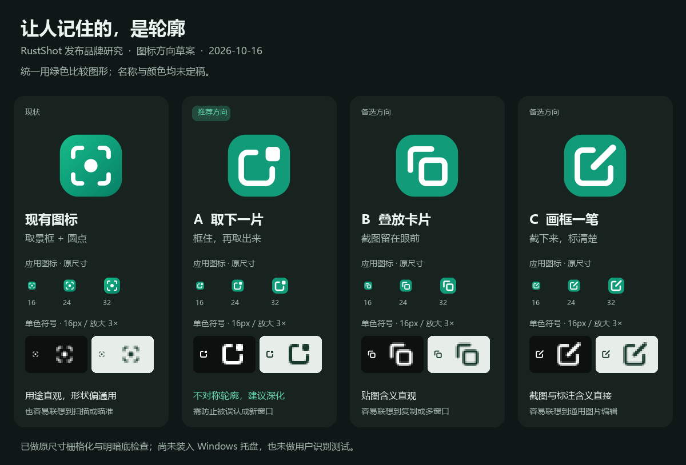

# 发布名称与图标研究

公开资料检索日期：2026-10-16。

当前决定（2026-10-23）：用户定名 **RaiShot**，仓库与动作名称用全小写 **raishot**，不加“截图”后缀；下文 RabShot、Kirie 与其它候选保留为研究经过。

本轮用于缩小候选，尚未定名，也未替换运行图标或修改程序名称。产品面向所有有截取屏幕内容需求的用户，不按职业细分命名。优先让人容易理解、记住和再次找到，再通过真实操作建立尝试理由。

## 名称：建议换掉 RustShot，先测试“框取”

不建议把 RustShot 作为正式发布名。公开已有另一个独立项目 [AChiabodo/RustShot](https://github.com/AChiabodo/RustShot)，描述为 Rust 编写的跨平台截图与调整尺寸工具，属于同品类同名。即使不讨论权利归属，也会增加搜索、下载和口头推荐时的混淆。Rust 是技术实现，普通用户仍需额外理解软件用途。

| 候选 | 值得保留的原因 | 需要验证的问题 |
| --- | --- | --- |
| **框取** | 优先测试。“框一下，取出来”贴近截图动作，也能容纳取字与贴图。 | 常用词，搜索辨识度可能不足；听一次后能否准确写出并找到软件。 |
| **轻截** | 短、好读，看到名字容易联想到截图。 | “轻”是体验承诺，需要启动、操作和常驻占用兑现；可能被理解为功能简单。 |
| **图栖** | 有独立品牌感，能表达内容留在桌面上供参考。 | 容易误当图库；“栖”有读音和输入成本。 |
| **Snipori** | 英语候选，snip 加自造词尾，保留截取暗示并增加区别。 | 可能听错、拼错；SNIP-uh-ree 仅为发音提议。有限检索尚未确认同名软件，不能据此承诺可注册。 |

本轮已检索候选精确词及“软件／截图”组合，Snipori 另查 app、software 与 GitHub。已排除 RustShot、拾图、Pinora、Framio、Clipora、Snapory；其中 [Snapory](https://github.com/volkanturhan/snapory) 已是 Windows 截图标注工具，[Clipora](https://www.clipora.cc/en_us/download) 用于网页快照、笔记标注与知识管理，[Framio](https://framio.org/) 用于照片边框及相机信息水印。相同或邻近用途已有名称，没必要在发布起点承担混淆成本。

这些是公开检索结果与产品判断，未做商标、域名或应用商店的完整核验，不构成法律判断。名称进入最终候选后再做相应核查。

## 同类品牌给出的启示

[Snipaste](https://www.snipaste.com/) 把名称拆成 Snip & Paste，直接讲截图后贴回屏幕；[PixPin](https://pixpin.cn/docs/start/what-is-pixpin) 明确来自 Pixel Pin，围绕截图与贴图扩展功能。这说明名称可以只承担一个清楚的动作，不必把 OCR、录屏全部塞进去。

[ShareX](https://getsharex.com/) 强调截图、分享与工作流；[Flameshot](https://flameshot.org/) 强调简单操作和即时标注；[Greenshot](https://getgreenshot.org/) 强调轻量截图、标注和导出。“截图／贴图／OCR／录屏一体化”已有多个选择。免费、本地 OCR、功能多都适合说明，却不足以单独解释用户为什么换用。

## 图标：推荐 A“取下一片”继续细化

现有 `assets/app.svg`（原 `assets/rustshot.svg`）是绿色方底、四角与中心点，能表达框选，也容易联想到扫描。它的轮廓较通用，后续名称变化时可以一起建立更明确的记忆点。

- **A，取下一片：推荐。** 开口框配一块独立小方片，表达把屏幕内容取出来；与“框取”和首发文案相连。需要检查小方片缩小后是否仍像同一符号。
- **B，叠放卡片：备选。** 容易理解内容留存与贴图，但也容易像复制、窗口切换或剪贴板工具。
- **C，画框一笔：备选。** 有截图后继续修改的含义，但可能被理解为图片编辑器。

托盘先看轮廓，商店再看质感。保持少细节，分别准备彩色与单色版本，并在深浅背景检查。微软的[应用图标设计指南](https://learn.microsoft.com/en-us/windows/apps/design/iconography/app-icon-design)也强调简单隐喻、清晰轮廓和小尺寸辨识；[Win32 图标说明](https://learn.microsoft.com/en-us/windows/win32/menurc/about-icons)列出的通知区域小图标在不同 DPI 下包括 16、24、32 px。[ShareX 品牌资产](https://getsharex.com/brand-assets) 同时提供 SVG、多种小尺寸和背景版本，可参考交付范围。当前三个方向均为概念，尚未证明用户识别效果。

设计源文件：[取下一片](../design/brand-study-2026-10-16/take-piece.svg)、[叠放卡片](../design/brand-study-2026-10-16/stacked-cards.svg)、[画框一笔](../design/brand-study-2026-10-16/frame-pen.svg)。A 另有[单独绘制的 16 px 托盘符号](../design/brand-study-2026-10-16/take-piece-tray.svg)，避免直接缩小应用底板。对照图由同目录 `render-board.py` 生成，实际栅格化了 16、24、32 px 应用图标与明暗底单色符号。

## 首发：把理解变成一次成功操作

建议首屏文案：**“把屏幕里的内容，取出来接着用。”** 下接“截图、标注、提取文字、贴在桌面”，先让用户知道能做什么。

用三个短演示建立尝试理由：截一块内容并修改标注；取出图中文字复制使用；把参考内容贴在桌面旁边。演示使用已验证功能，暂不承诺独家、最快或未经实测的性能指标。下载后优先引导完成一次截图与复制，让品牌承诺立即落到结果上。

## 最小验证与下一步

先找 5–8 位未参与开发的人做探索试用，样本不代表市场。随机展示候选名称 5 秒，询问软件用途；隔 10 分钟再让其回忆名称并输入搜索词，记录原话和错字，并检查搜索词是否能准确指向候选名、结果是否被已有产品淹没。候选尚未上线，不能拿搜索不到本产品作为失败依据。不要先解释名字含义，也不只问“喜欢哪个”。

图标按 16 px 和 32 px 原尺寸混在常见托盘符号中，在深浅背景分别找出；再看能否对应到截图动作、A 的小方片是否粘连或消失。分别记录识别和误解，再决定名称与图标组合。本轮没有实际参与者测试结果。

本轮完成公开资料检索、候选整理与图形方案渲染检查；仅涉及文档和设计稿，无需 cargo。未验实际托盘效果、用户回忆、搜索获客和发布转化；后续应先完成名称回忆及小图标识别试用，再定稿并统一替换品牌资产。

## 后续英文名比较：ReShot、RainShot 与新候选

用户随后提出 ReShot 和 RainShot，均未定名。短、能自然发音、有独立视觉意象是这轮主要筛选标准，不要求名称逐项描述功能。

- **ReShot**：名字短，容易拆读，但已有 [Reshot 截图／录屏 CLI](https://github.com/reshotdev/screenshot)、[ReShot 视频编辑器](https://reshot.io/)与[分析截图的 iOS 项目](https://github.com/lupuletic/reshot)，搜索混淆较明显，暂不建议首选。
- **RainShot**：rain + shot 易读写，有雨滴意象。已有 [rainshot 降雨雷达抓图项目](https://github.com/cheeaun/rainshot)，不能说名称无人使用。用户随后指出近似竞品 [Snow Shot](https://snowshot.top/zh/)：官网展示截图、标注、文字识别、录屏及贴图，与本品同类。“雨／雪＋Shot”的结构和意象都接近，接触过 Snow Shot 的用户可能误认为同系列或模仿；这是品牌联想判断，不能据此推断主观蹭品牌意图。此前只查同名时把 RainShot 排为首选过早，现建议降低优先级，继续找区别更清楚的名称。

新增值得比较的英文名：

| 候选 | 意象与辨识方向 | 主要取舍 |
| --- | --- | --- |
| **MicaShot** | mica（云母）＋shot；晶片、切面或叠层轮廓，偏简洁的桌面软件品牌 | mica 对部分用户是生词，需要建立读音与用途认知；也不应把 Windows 的材质名称当作官方关联 |
| **GlintShot** | glint（闪光）＋shot；捕捉一闪的画面，图形可以用开口框与单一亮点 | 读音中的辅音较密，口头拼写需要验证 |
| **DewPin** | dew（露珠）＋pin；六个字母，露珠与悬浮卡片，可覆盖截图后留下参考的工作流 | 名字更偏贴图，初期需要截图副标题；dew 听写可能与 do 混淆 |
| **PlumeShot** | plume（羽毛）＋shot；羽片或轻盈轮廓，有独立意象 | plume 不如 rain 常见，中文用户读写成本较高；不能仅凭名字声称程序轻量 |

上述四个新候选均做了名称及 app／software／screenshot 组合的有限公开检索，MicaShot、GlintShot、DewPin 还检索了 GitHub 或精确词；暂未发现可确认的同名截图或相邻成品软件。搜索中有网友名、代码字段或游戏技能等非成品用法；不等于名称全球唯一，也未验证商标、域名和商店保留名。新候选中优先比较 MicaShot 和 DewPin；后续核查应同时看同名与同品类的近似意象、命名结构，不再只查精确同名。所有候选均未定稿。

## 定名：Kirie（2026-10-18）

用户定名 **Kirie**（切り絵，剪纸：从屏幕上剪下一片），与图标方向 A“取下一片”一致。比较过程中排除了：RainShot（与同类开源工具 Snow Shot 的命名结构和意象过近，后者同为 GPL-3.0、Windows、截图／OCR／录屏）、Dewpin（中文用户难按拼写读出，易被看成 DePIN，且与 PixPin 同为“XxPin”结构）、Tessera（同名软件过多）。新增筛选标准：中文用户看拼写即可念对。有限公开检索未发现同名截图软件；商标、域名与应用商店仍未核验。

工程上品牌与内部代号分开：对外名称只在 `src/brand.rs` 等少数位置定义，内部代号 rustshot 不随品牌改名，以后再改名只动品牌层并在 `LEGACY_NAMES` 追加曾用名。

## Quicker 动作图标（2026-10-18）

为 V1/V2 共用动作设计三版：[A 取下一片](../design/quicker-action-icon-2026-10-18/take-piece.svg)、[B 剪纸切角](../design/quicker-action-icon-2026-10-18/paper-cut.svg)、[C 剪纸 K](../design/quicker-action-icon-2026-10-18/paper-k.svg)。统一翡翠绿底与白色主体；B/C 加少量薄荷绿，外边缘透明，不加名称或版本角标。

推荐 A，延续已选品牌意象，并放大主符号：24 px 时框线约 2 px，独立方片与框线留约 2.3 px 净间隙。B 的切角与移出三角片同形同向，避免像折角文档；C 的斜笔与竖笔相接，保证能读成 K。

已输出可编辑 SVG、24–512 px PNG 与 A 的透明底单色版；[深浅底对照](../design/quicker-action-icon-2026-10-18/comparison.png)包含 24／32／48 px 原尺寸，尺寸与透明边缘检查通过。仅设计候选，未替换动作或应用运行图标；待用户选定后接入发布资源，实际 Quicker 面板未验。

## 主流截图产品与重新命名（2026-10-18）

用户认为 Kirie 虽然特别，但完全不能直接联想到截图，要求重新调查主流名称后推荐。此次将“看到名字能联想到截图/框选/截取、中文用户易读易记”置于独特寓意之前；现有代码和账号名称暂不再改动。

### 调研口径

以下核对 41 款独立应用或扩展，以及 6 个系统/应用内置入口，覆盖桌面、网页协作与手机长图。以厂商官网、官方代码库或开发者应用商店页面为来源；这是主流和经典工具的广覆盖清单，不是下载量或市场份额排名，也不能声称穷尽全球所有产品。仅用于产品命名研究，没有逐一安装或实测功能。

### Windows、Linux 与跨平台桌面

| 名称（官方入口） | 平台/形态 | 主要特点 |
| --- | --- | --- |
| [Snipaste](https://www.snipaste.com/) | Windows / macOS / Linux | 截图、贴图 |
| [PixPin](https://pixpin.com/docs/start/quick-start) | Windows / macOS | 截图、贴图、长截图、OCR |
| [ShareX](https://getsharex.com/) | Windows | 截图、录屏、上传与自动化 |
| [PicPick](https://picpick.app/en/) | Windows | 截图编辑、取色与屏幕测量 |
| [FastStone Capture](https://www.faststone.org/FSCaptureDetail.htm) | Windows | 滚动截图、录屏、图片编辑 |
| [Snagit（官网现称 Camtasia Snagit）](https://www.techsmith.com/snagit/) | Windows / macOS | 截图标注、步骤说明、录屏 |
| [Lightshot](https://app.prntscr.com/en/index.html) | Windows / macOS；扩展 | 快速框选、编辑与链接分享 |
| [Greenshot](https://getgreenshot.org/) | 主要 Windows | 截图、标注与多种导出 |
| [Screenpresso](https://www.screenpresso.com/) | Windows | 截图、录像、编号说明 |
| [Ashampoo Snap](https://www.ashampoo.com/en-us/snap) | Windows | 截图、录屏、OCR 与编辑 |
| [HyperSnap](https://hyperionics.com/hsdx/) | Windows | 滚动截图与图像编辑 |
| [Flameshot](https://flameshot.org/) | Linux / Windows / macOS | 开源、选区内即时标注 |
| [ksnip](https://github.com/ksnip/ksnip) | Linux / Windows / macOS | Qt 跨平台截图与标注 |
| [Spectacle](https://apps.kde.org/spectacle/) | Linux / KDE | 桌面环境截图工具 |
| [Shutter](https://shutter-project.org/) | Linux | 截图、标注、教程配图 |
| [eSearch](https://github.com/xushengfeng/eSearch) | Windows / macOS / Linux | 截图、OCR、搜索翻译、贴图 |
| [Snow Shot](https://snowshot.top/zh/index.html) | Windows / macOS | 截图、标注、贴图、OCR、录屏 |
| [小旺 AI 截图](https://www.xiaowang.com/) | Windows / macOS | 截图、长截图、OCR、AI 解释 |
| [Screenshot Captor](https://www.donationcoder.com/software/mouser/popular-apps/screenshot-captor) | Windows | 经典截图、编辑与批量工作流 |
| [Lightscreen](https://lightscreen.com.ar/) | Windows | 后台快捷键截图、保存与上传 |

### macOS 为主的桌面工具

| 名称（官方入口） | 平台/形态 | 主要特点 |
| --- | --- | --- |
| [CleanShot X](https://cleanshot.com/features) | macOS | 截图、OCR、贴图、录屏、美化 |
| [Shottr](https://www.shottr.cc/) | macOS | 截图、滚动、OCR、像素测量 |
| [Xnapper](https://xnapper.com/) | macOS | 截图自动居中与美化 |
| [iShot](https://www.better365.cn/) | macOS | 截图、长截图、贴图、OCR、录屏 |
| [Capto](https://www.globaldelight.com/capto/windows) | macOS / Windows | 截图与网页捕获、录屏和编辑 |
| [Longshot](https://longshot.chitaner.com/zh-cn/) | macOS | 长截图、OCR、贴图与测量 |
| [ScreenFloat](https://www.eternalstorms.at/ScreenFloat/) | macOS | 截图悬浮、编辑、OCR 与管理 |
| [图几](https://apps.apple.com/cn/app/id6479216439?mt=12) | macOS | 截图、标注、美化 |

### 浏览器、云分享与协作

| 名称（官方入口） | 平台/形态 | 主要特点 |
| --- | --- | --- |
| [Awesome Screenshot](https://www.awesomescreenshot.com/) | 浏览器；另有桌面/移动应用 | 整页截图、标注、录屏与分享 |
| [FuseBase Capture（原 Nimbus Capture）](https://thefusebase.com/screenshot/) | Chrome / Edge 扩展 | 网页截图、录屏与协作 |
| [GoFullPage](https://gofullpage.com/) | Chrome / Edge / Firefox 扩展 | 整页长截图与 PDF 导出 |
| [FireShot](https://getfireshot.com/) | 浏览器扩展 | 网页截图、批量、PDF 与标注 |
| [Droplr](https://droplr.com/products/screenshot-screen-recorder/apps/) | Windows / macOS；扩展 | 截图、录屏与云链接分享 |
| [Markup Hero](https://markuphero.com/download) | Windows / macOS / Linux Beta；网页 | 截图、图片/PDF 标注与协作 |
| [Monosnap](https://monosnap.ai/) | Windows / macOS；扩展 | 截图标注、录屏与云存储 |
| [Gyazo](https://help.gyazo.com/Capture%20and%20upload%20desktop%20screen-6a87d64fe7891be6c1d7e442) | Windows / macOS | 截图后自动上传并生成链接 |
| [Zight](https://zight.com/) | Windows / macOS / Chrome | 截图、录像与团队沟通 |
| [ScreenRec](https://screenrec.com/screenshot-tool/) | Windows / macOS / Linux | 截图、标注与私有链接分享 |
| [Dropshare](https://dropshare.app/) | macOS / iOS | 截图、标注与存储分享 |

### 手机长截图与拼接

| 名称（官方入口） | 平台/形态 | 主要特点 |
| --- | --- | --- |
| [Picsew](https://picsew.app/) | iPhone / iPad | 滚动长截图与多图拼接 |
| [Tailor](https://apps.apple.com/us/app/tailor-screenshot-stitching/id926653095) | iPhone / iPad | 自动拼接重叠截图 |

### 系统与应用内置入口

| 名称（官方入口） | 平台/形态 | 主要特点 |
| --- | --- | --- |
| [Windows 截图工具 / Snipping Tool](https://support.microsoft.com/en-us/windows/apps/use-snipping-tool-to-capture-screenshots) | Windows | 系统截图、标注、录屏 |
| [Screenshot / 截屏](https://support.apple.com/en-us/102646) | macOS | 系统截图与定时捕获 |
| [Microsoft Edge Screenshot](https://www.microsoft.com/en-us/edge/features/screenshot) | 浏览器 | 整页/区域截图与标注 |
| [Firefox Screenshots](https://support.mozilla.org/en-US/kb/take-screenshots-firefox) | 浏览器 | 网页元素、区域和整页截图 |
| [飞书截图](https://www.feishu.cn/hc/zh-CN/articles/319286513754) | 桌面应用内置 | 截图、标注、贴图和识别 |
| [Quicker 截图 Pro](https://docs.getquicker.net/v2/features/screenshot/capture-pro/) | Quicker 原生模块 | 截图、标注、贴图与长截图入口 |

QQ、微信、钉钉也有常用截图入口；此处没有将聊天工具当作独立截图产品重复计数，也不据未核实资料扩写它们当前的精确功能。录屏/GIF 邻近工具还有 [ScreenToGif](https://github.com/NickeManarin/ScreenToGif)，但它不作为截图主表项目。

历史产品需要区别对待：[TechSmith Capture（原 Jing）](https://www.techsmith.com/solutions/capture-tool/)官方已宣布退役，不能作为仍可下载的新产品推荐；[Skitch 原产品页](https://evernote.com/products/skitch)当前重定向 Evernote 首页，本轮未取得可读厂商公告，不推断精确停更日期。CleanShot Cloud 是 CleanShot X 的配套服务，不另算一款。

### 名称规律与取舍

以下是对名字的语言分析，不冒充厂商命名沿革：

- Shot / Snap / Snip / Capture / Screen 都提供了截图、快照或屏幕捕获的线索，例如 Lightshot、Flameshot、CleanShot X、HyperSnap、Snipaste、Screenpresso。
- Pic / Pix 加操作词也成立，例如 PicPick、PixPin；名称可以只突出截图或贴图之一，不必把 OCR、翻译和录屏全写进去。
- ShareX、Gyazo、Zight 等说明抽象名也能成为品牌，但不符合这次希望减少用途解释的偏好。
- 英文简单组合很拥挤，不能只凭“好听”就进入定名；同类精确同名或容易误认成同一系列的组合优先排除。

### 新候选

| 候选 | 适合的方向 | 主要取舍 |
| --- | --- | --- |
| **随截** | 中文优先。来自“随手一截”，短、好说，用途直接 | 品牌感偏朴素；“随手”不应被理解为功能简陋 |
| **截绘** | 强调截图后就地标注、画箭头与说明 | 同音“结汇”，口头输入需要补一句“截图的截，绘画的绘” |
| **截贴** | 直接表达截图与贴图两项核心工作流 | 与 Snipaste 的功能表达接近，区别主要靠名称本身与视觉 |
| **ShotTap** | 英文优先。shot + tap，7 个字母，捕获与按一下的动作线索 | tap 也会联想到触屏；不是现成英语短语，读作两个词即可 |
| **SnipHold** | 强调截取并留在屏幕上，对应贴图 | 比 ShotTap 更需要英语基础，hold 也不等于专门的置顶术语 |
| **SnipLeaf** | 保留截取词根与“取下一片”的图形延续性 | leaf 仍是第二层隐喻，直观性低于中文候选 |

本轮建议先比较 **随截 / 截绘 / ShotTap**；中文与英文配套可以测试“随截 ShotTap”，没有决定更改当前品牌。以上候选做了精确词与软件/截图组合检索，ShotTap 另查 GitHub 与应用商店的搜索索引；暂未定位明确同类同名成品。搜索未命中不是名称可用性的保证，商标、域名与商店名称尚未完整核验。

### 已排除的新碰撞

- [Snipmark](https://snipmark.app/)、[ShotKeep](https://shotkeep.app/)、[ShotPad](https://github.com/TuranIsmayilov/shotpad)、[ShotFold](https://shotfold.com/)已有截图产品，不再推荐。
- [ShotDesk](https://shotdesk.co/)已有影视/摄影工作室软件；[MintShot](https://mintshot.app/)和[Mintshot](https://mintshot.ai/)已有摄影相关产品，属于相邻影像领域。
- [截记 SnapMark](https://apps.apple.com/jp/app/id6764744014)已有截图标注应用。
- **SnipAI**（用户新提）：Snip 提供截取线索，语义比 Kirie 直接；但已有 [booboom/snipAI](https://github.com/booboom/snipAI) 同名 macOS/Windows 截图、贴图、标注、滚动截图、录屏项目，以及 [Google Play 的 SnipAI: Screenshot Assistant](https://play.google.com/store/apps/details?id=com.snipai.app&hl=en)。同类精确同名，不建议正式发布使用；AI 后缀还会让用户预期智能分析是主卖点，这是定位判断。
- “截刻”虽然可联想“截下此刻”，但[词典](https://cd.hwxnet.com/view/nmegobmnkoadnpcf.html)有不适合品牌的旧词义，直接排除，不作为推荐候选。

## 最终定名 RabShot（2026-10-18）

用户提出 Rabbit Shot 并希望缩短、保留速度感，最终决定 **RabShot**，7 个字母。Rab 是从 Rabbit 截短而来的品牌构词；Shot 提供截图联想。动作名按用户明确要求仅写 **rabshot**；产品展示名写 **RabShot**，程序为 `rabshot.exe`／`rabshot-gpui.exe`／`rabshot-cli.exe`。

`src/brand.rs` 统一标题、数据目录、开机启动项与 User-Agent，曾用名保留 RustShot、Kirie；若两处旧数据并存，优先迁移最近的 Kirie，已有 RabShot 目录则直接使用，不合并、不删除其它旧目录。通用打包的 OCR 缓存回退同样优先 Kirie。程序内部代号 rustshot、Quicker 包标识 `cea.rustshot` 和窗口类保持。

本次同步当前源码、动作源、便携说明、公开入口与发布配置；GitHub 远端仍使用真实的 `ceastld/Kirie` 地址。旧候选图标与既往分发记录保留，不把旧包描述改成新构建。

验证：`cargo check --lib --bins` 与 4 项品牌定向测试通过，覆盖两个曾用名分别迁移、旧名并存时的选择、当前目录优先和标题；37 项动作离线测试、脚本语法与差异检查通过。V1 本地动作与 V2 账号动作标题独立回读为 `rabshot`；V2 客户端待同步。`cargo build --bins` 通过，新 Dev 运行副本的 Quicker 启动、截图与取消实测通过；0.4.12 为未发布草稿，Release 后续由 CI 构建，本次未打包或发布。

## 当前定名 RaiShot（2026-10-23）

用户决定将仓库与产品统一改名：展示名 **RaiShot**，仓库为 `ceastld/raishot`，动作名为 **raishot**，程序为 `raishot.exe`／`raishot-gpui.exe`／`raishot-cli.exe`。GitHub 主仓库与本机 `origin` 已同步，本机工作目录保留，避免影响并行开发与增量构建。

品牌层同时决定窗口标题、数据目录、开机启动项与 User-Agent。`LEGACY_NAMES` 追加 RabShot，旧数据按 RabShot、Kirie、RustShot 的顺序迁移；已有 RaiShot 目录时直接使用，不合并其它目录。旧开机启动项沿用迁移流程；OCR 打包缓存按同样顺序回退。内部代号 rustshot 与现有动作身份保持。

当前源码、便携说明、文档、动作源及发布配置同步新品牌；历史下载记录与旧包名保留。动作源需随下一份包含新 EXE 的依赖包一起发布。

验证：`cargo check --lib --bins` 通过；`cargo test --lib -- brand autostart` 筛选出的 13 项全过，其中品牌与开机启动项 8 项覆盖三个曾用名的数据迁移、当前目录优先与最近旧名选择，以及旧启动项的启用／系统禁用／其它程序保护。动作离线测试 38 项、元数据测试 17 项和脚本静态语法检查通过。未重建或替换本机运行版，真实界面未验；未打包、上传或更新线上动作。
