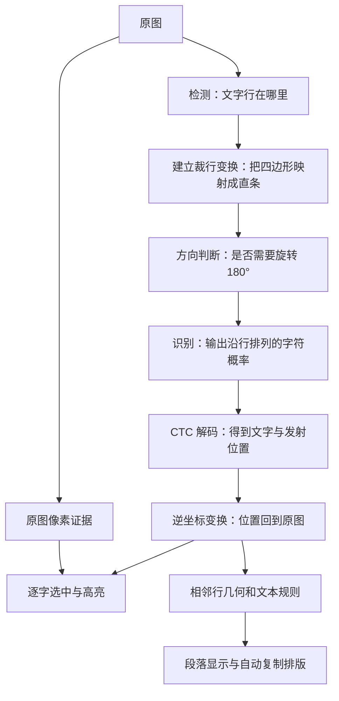

# OCR 为什么能逐字选中，选字框和段落又为什么会出错

本文说明 RaiShot 当前使用的 PP-OCRv6 识别流程，以及识别之后的选字框和段落处理。**识别出了什么字、每个字大约在哪里、哪些行属于同一段，是三个不同的问题。** 第一个主要由模型回答，后两个还需要几何推算和规则判断；文字识别正确，不代表框已经贴合笔画，也不代表段落一定正确。

## 从图片到文字，模型做了什么

PP-OCR 是由多个任务组成的 OCR 方案。RaiShot 当前提供 Tiny 和 Small 两种模型配置，管线包含检测、文字行方向判断和识别。官方通用管线还提供整页方向和文档展平等可选模块，这不表示 RaiShot 自动启用了这些模块。[PaddleOCR 通用管线说明](https://www.paddleocr.ai/main/en/version3.x/pipeline_usage/OCR.html)



**检测**回答“哪里有一行文字”，通常先产生文字区域的概率图，再从区域轮廓得到框。可以把它想成先在地图上涂出“可能是文字的地方”，再为每块区域画边界。DB 是这类方法的重要基础，论文讨论了如何把概率图转成文字区域。[DB 原论文](https://arxiv.org/abs/1911.08947)

在 RaiShot 中，检测结果经轮廓、外扩和四边形计算，得到适合裁行的区域。这个区域需要保住整行文字，不能因为边缘收得过紧而漏掉细笔画、标点或上下伸出的部分。它的职责首先是为识别提供可靠输入。

**裁行与方向判断**把倾斜的文字四边形映射成一条适合模型读取的长条，再判断是否倒置。当前方向模型区分 0° 和 180°；RaiShot 对长行分窗采样，再综合判断方向，避免把很长的一行硬压到很窄后误判。识别阶段按比例缩放内容并补齐输入宽度，保留把位置映射回原图的变换。

**识别**读取整条图像，输出沿行排列的字符概率。这里的序列位置常叫“时间步”，但对截图来说可以理解成模型沿着文字行走过的一系列采样位置。它不是先把图片准确切成一个个字，再逐字分类。

也不宜把所有 PP-OCR 版本都理解成固定的一套卷积加循环网络。PP-OCRv6 的识别设计因模型档位而异：官方说明 Tiny 去掉了中间的 neck，直接 reshape 后接全连接层；推理使用 CTC 分支，NRTR 分支用于辅助训练，推理时移除。[PP-OCRv6 识别架构](https://www.paddleocr.ai/latest/en/version3.x/algorithm/PP-OCRv6/PP-OCRv6.html)

## CTC 为什么能读出字，却不直接给出笔画边界

CTC 让模型可以在没有逐个字符切分标注的情况下学习序列。解码时，连续重复的标签合成一次，再移除特殊的 `blank` 标签。例如：

```text
模型路径：A  A  blank  B
合并重复：A     blank  B
移除 blank：AB
```

`blank` 表示这个位置不输出字符，它不是文本里的空格。真正重复的两个字需要能够区分，例如 `A blank A` 解码为 `AA`，不会被删成一个 `A`。[CTC 原论文](https://www.cs.toronto.edu/~graves/icml_2006.pdf)

RaiShot 使用模型输出中的发射位置估计文字在行内的分布，并结合裁行变换映射回原图。这比把整行按字符数平均分开更能适应英文宽窄字、中文、标点和空格。但发射位置表示“模型在这里作出了这个判断”，不等于“这个字的左侧笔画就在这里”。模型还会利用相邻内容判断一个字，所以识别正确与边界精确是两种不同的能力。

这一点解释了为什么当前逐字选择可以已经很准确，同时高亮框上下仍留有明显空白：横向的分界有较好的序列证据，竖向却可能仍继承整行裁图的高度。

## 为什么不能把所有框统一缩小一点

“框大”可能来自不同环节，不能只靠一个缩放比例修好。

| 来源 | 为什么会留白 | 直接缩小的风险 |
| --- | --- | --- |
| 检测和外扩 | 为识别保留完整文字与边缘余量 | 截掉细笔画、句号或上下标 |
| 行内位置推算 | CTC 给出序列证据，没有逐字墨迹轮廓 | 改坏原本准确的横向分界 |
| 共用整行高度 | 一个词可能沿用整行裁图的上下边缘 | 单独收紧句号、逗号后，高亮高度忽大忽小 |
| 轴对齐包围框 | 倾斜四边形包进水平矩形后自然多出角部空白 | 把倾斜文字误当成普通水平文字裁剪 |
| 图像本身 | 抗锯齿、阴影、低对比、渐变和邻近图标 | 把浅色边缘当背景，或把背景当笔画 |

因此更可靠的方向是：**保留原来的识别与横向定位证据，用原图中可信的笔画证据收紧显示高度；证据不足时保持原框。** 普通的深色字配浅底、浅色字配深底比较容易判断；照片底、渐变底、彩色字、邻近边框和很浅的文字更需要保守处理。文字的识别置信度也不能直接代替边界置信度，模型读对一个字，并不证明某条像素边缘安全可裁。

“贴合每个字的墨迹”与“适合连续阅读的选择高亮”也不完全相同。句号、英文小写字母、带下伸部的字母和汉字高度各异，如果逐字追着最小墨迹框走，同一行高亮会上下跳动。整行共享可信的上下范围，可以减少留白，同时保持选字的连贯性。

## 段落合并实际如何判断

段落合并发生在识别之后。当前算法只比较源文中相邻的两行，判断换行是“页面宽度不够产生的自动折行”，还是“内容主动换了一段”。它保留识别文字，只在自动排版时替换被判定为同段的换行。段落面板和自动复制排版共用这一份判断，具体实现见 `src/recognition_layout.rs`。

可以用一个直观问题理解主要规则：**如果下一行开头的词本来放得进上一行，为什么上一行提前停下？** 这通常是主动换行的迹象。反过来，上一行已经接近栏宽，下一行又在相近位置继续，才有自动折行的证据。

为了避免把不同栏、列表、代码和聊天记录串起来，实际实现还有以下限制。这里“框高”是识别行框的高度，“行距”是相邻行中心的距离，不是笔画之间的净空。

| 判断依据 | 当前主要规则 | 通俗例子 |
| --- | --- | --- |
| 是否属于同一局部块 | 两行高度差不超过 30%；中心行距为较小框高的 0.6–2.2 倍；水平重叠至少达到窄行宽的一半 | 同页左右两栏通常不直接连起来 |
| 段间空隙 | 多行时，行距同时超过块内中位数 25%、多出框高 25%才断；只有两行时，超过框高 1.45 倍就断 | 正文中间明显空了一行，通常是新段 |
| 首行缩进 | 下一行向右缩进至少半个框高通常断段；允许段首缩进后的第二行回到左缘 | 中文新段开头空两格 |
| 上一行是否写满 | 行尾空余放得下下一行首词，再多一个字宽，就保留换行 | 标题和主动换行的短句不应硬拼 |
| 短行保护 | 上一行宽度小于 8 倍框高，保留换行 | 聊天和短列表即使对齐也逐行保留 |
| 列表和结构化文字 | 新编号、圆点、复选框等断段；带标记行只接合适的悬挂缩进续行；代码、表格迹象保护换行 | `1. 安装` 与 `2. 运行` 各自成段 |
| 句末与轻微段间距 | 中文句末且未写满栏时断段；行距明显分两档时，较大档配合句末符号也可断段 | 圆点漏识别，但列表项之间稍微更疏 |

最后一条的“两档行距”要求至少三个行距，也就是至少四行；较小档至少包含两个相近行距，两档差至少达到框高 12%、较小档波动的两倍、较小档行距 10%。这是为了避免检测框几像素抖动就把正文拆开。行首的 `09:21`、`3.14`、`2.0` 则特意避开普通编号判断。

合并后，中文正文之间通常去掉换行而不加空格，英文之间加一个空格；英文断词连字符保留。原始空白、字符内容和组合字边界另有保护，不靠段落算法顺便改写原文。

## 哪些错误无法只靠调阈值解决

假设两段文字左边缘相同，上一段恰好写满栏宽，段间距又等于普通行距，列表圆点也没有进入识别结果。它与“同一段落正常折行”可以具有完全相同的文字和几何输入。对只接收这些信息的算法而言，两者无法可靠区分。

现有保守规则也有代价。例如宽 180 像素、高 30 像素的窄栏正文，可能被短行保护拆开；两行正文中心距 45 像素、框高 30 像素时，会触发两行的 1.45 倍阈值，但增加第三行后，算法可以估计正常行距，同一处换行的判断就可能不同。这些是由规则可推导的边界，不是本次实测出的错误比例。

大模型能利用语言和版面上下文改善一部分判断，但仍然会遇到截图信息缺失、内容歧义和识别错误，不能保证完全避免误合并或误拆分。是否主动改写文字，还需要额外控制。

本轮不直接放宽段落阈值：只修一张网页，可能同时破坏短列表、窄栏或聊天。应先保留真实截图和模型输出，在每个换行处标注“续行／新段／有歧义”，分别统计误合并、误拆分，并使用未参与调参的样例复核。现有回归覆盖正文、首行缩进、悬挂列表、代码、聊天和漏圆点列表等情况，但不能替代新场景的真实样例。

需要忠实保留换行时，可以使用逐行／原文排版；需要连贯段落时使用自动排版，再对少数歧义边界人工确认。保留原文视图让自动算法的判断可以被检查和纠正。

## 第一轮：统一行高与样例结果

### 这次改动解决什么

此前已经有逐词收紧代码，但逐字选择为了保持同行高度一致，会重新沿完整裁行构建连续单元，因而覆盖了词级高度的改进。这也是单纯调整逐词阈值不一定能改变屏幕高亮的原因。

本次增加一份独立的整行选区几何，仍沿用原来的 CTC 横向位置，只把整行的上下边缘一起向中间收。它不覆盖原始行几何，也不参与段落分析；所有字共享同一行高，标点不会单独缩成很矮的一块。没有完整、有效的字素来源证据时仍走原有回退路径。

整行像素检查的原则如下：

1. 在未经缩放的原图上检查整条裁行及外侧一圈像素，要求外围背景高度一致。原图边缘不够完整、范围过大或背景不可靠时不收紧。
2. 文字须有足够的深浅对比、极性一致，并且沿高度形成一个连续的带；明显边框或两条分离内容不作为安全行高证据。
3. **所有非背景像素都参与保护，包括只比背景差一个色阶的抗锯齿边。** 主体阈值只用于确认有足够证据，不用它决定哪些淡像素可以被裁掉。
4. 取上下留白中较小的一侧，最多使用其中 80%来对称收紧，保留另外 20%的保护余量；每侧最多缩掉原高度的 35%。文字明显偏心时，这个保守选择仍可能留下较多空白。
5. 收紧后再用新投影检查每个非背景像素的完整像素单元是否仍被包含，验证原阅读方向及实际 CTC 中线停点；不满足就保留原高度。

因此这不是通用字形分割：照片、渐变、彩色混合文字、边框、噪声和低对比内容仍可能保留较大的框。这里优先保护笔画和当前选字能力，再改善普通界面文字的留白。

### 实际 PPOCR 样例

使用当前固定 Tiny／Small 模型实际推理。行高对照取同一次推理的原行几何与新增选区几何，排除重跑模型波动；它测的是选字行高变化，不是模型识别准确率。

| 输入 | 模型 | 收紧行数 | 行高收缩中位数 | 收缩范围 |
| --- | --- | --- | --- | --- |
| 真实浅色对话框 | Tiny | 5 / 5 | 27.15% | 17.05%–34.72% |
| 同一真实浅色对话框 | Small | 5 / 5 | 31.32% | 17.05%–34.96% |
| 左侧文字被裁断的真实深色截图 | Tiny | 0 / 7 | 0% | 保留原高度 |

三组另外分别与修改前 Dev CLI 保存的独立推理结果比较，全文、词文字及所属行、词框和原始几何四角均相同，词数分别为 43、43、25。它们确认这几张样例中原识别结果没有改变，不代表所有图片上的模型准确率。真实截图没有手工文字掩码，因此只作几何测量与叠图检查，不报告它们的“墨迹覆盖率”。

本机叠图位于 `output/ocr-ink/dialog/report.html`、`dialog-small/report.html` 和 `dark/report.html`；正文的前后对比图位于 `output/ocr-ink/dialog/comparison.png`。均离线生成，不需要打开样例窗口。

对白底正文两行另外逐像素检查了四边留白：背景为纯白，所有与背景不同的 RGB 像素均计入，包括只差一个色阶的抗锯齿。以下距离相对完整像素单元计算，是这一具体截图的像素分析，不是人工标注真值。

| 正文行 | 左余白 | 右余白 | 上余白：原 → 新 | 下余白：原 → 新 |
| --- | --- | --- | --- | --- |
| 第一行 | 5.78 px | 3.17 px | 5.61 → 2.60 px | 3.77 → 0.75 px |
| 第二行 | 8.16 px | 5.85 px | 7.60 → 3.57 px | 5.04 → 1.01 px |

两行的全部非背景像素单元仍被候选框包含。这说明本轮统一行高有效，但左右也存在可见的外沿余白，不能笼统说左右已经完全贴合。左右余白分别占两行宽度的 1.31%和 4.30%；它只证明整行首尾还有空间，不证明内部 CTC 字间分界有错。进一步优化应单独处理整行首尾，保持内部字间分界，不能把整条行框横向缩放后带着所有字的位置一起移动。

深色合成控制台中的英文代码行与中文行也有约 3–6 像素的左右余白，上下收紧后所有非背景像素单元仍完整包含。对白底对话框 5 行和深色控制台 6 行共 11 个固定区域检查时，外围均为纯背景，连差一个色阶的抗锯齿也纳入保护。逐行余白、固定检查区域与背景取值记录在 `output/ocr-ink/margin-audit.json`，这仍是具体像素分析，不替代独立掩码测试。

另外对既有 16 张合成场景图执行真实 Tiny 推理：共 154 行，99 行收紧；收紧行的高度收缩中位数为 29.12%，全部行的中位数为 20.06%。行中线在五个阅读位置的最大浮点位移约 0.000051 像素，没有超过 0.05 像素的行。该组用于扩大场景检查，不是新增独立留出，也没有独立文字掩码，不能据此估算真实生产场景的漏字率。逐图报告在 `output/ocr-ink/corpus/`。

### 独立像素覆盖测试

109 张排版合成样例另有独立绘制的文字掩码，包含字体字号、明暗与彩底、低对比、标点、边框、图标、噪声、模糊、JPEG、偏心和旋转。直接调用本次整行像素算法，不运行检测和识别模型：52 张成功收紧，109 张均达到各自覆盖要求，最低文字像素覆盖率为 100%。

其中 105 张有文字、4 张无文字；非空样例的覆盖率 P05 也为 100%。52 张收紧样例的面积收缩中位数为 64.00%，但它们使用预设的宽松检测框，不能与真实 OCR 框的收缩幅度直接比较。

覆盖率按掩码中所有非零像素的中心落入输出四边形计算，掩码像素数逐张核对清单。无文字样例经文字门槛保持原框；这不能称为像素算法自身的负样例拒绝率。样例中复杂背景和边框仍有保守回退，不能把 100%的覆盖率理解成所有框都变紧，或理解成真实截图中的通用保证。详细逐图结果在 `output/ocr-ink/masks/mask-report.json`。

### 复现入口与验证范围

`src/ppocr/ink_bounds_actual_qa.rs` 中的两个手动测试默认忽略，不令默认构建或测试依赖仓库外的文件。显式指定样例后运行：

```powershell
# RUSTSHOT_INK_FIXTURES：带独立文字掩码的 manifest.json
# RUSTSHOT_INK_IMAGE：原始 PNG，或仅扫描当前层 PNG 的目录
# RUSTSHOT_INK_OUT：输出目录；RUSTSHOT_INK_PROFILE：tiny 或 small
cargo test --lib ink_fixture_pixel_coverage -- --ignored --nocapture --test-threads=1
cargo test --lib ink_actual_ocr_report -- --ignored --nocapture --test-threads=1

python Tools/evaluate-ocr-ink.py --image sample.png --before before.json `
  --after after.json --output report.html
```

编译检查通过。实际执行的定向回归中，墨迹相关 54 项、字素选字 25 项、真实 CTC 到选字的接线 1 项通过，覆盖淡抗锯齿像素、标点、倒置／双向竖排／透视、来源失效、取消和预算。一条旧续行测试的原样例宽 160、高 40，不满足既有的八倍行高短行保护，在收紧之前就会触发前置断言失败；改成符合规则的长行后已定向重跑通过，未调整段落算法。

真实应用中的拖选和标记交互未验证，本轮未重启用户的常驻程序。

## 第二轮：左右首尾留白与轻斜框

### 首尾只裁外沿，内部不重新分配

原图的完整像素单元在阅读坐标中提供最左和最右的支撑范围。两端各自保留原余白的 20%，且至少留半个物理像素；不足半像素的移动不执行。两端范围独立保存，既不覆盖原裁行，也不把裁短的框当成新的文字坐标系。

选字仍按原来的 CTC 中心和相邻中心中线构建。完成后只修改第一字的起边和最后一字的止边，内部字素、空格来源和字间停点保持。某一端若要跨过已有的内部字间边界，就放弃该端；另一端和行高仍可独立生效。单字可以同时收两端，不再均分或横向缩放整行。

### 水平与原倾角竞争，避免强行拉平真斜字

只把角度小于某个值的框拉平，会误改真正浅斜的文字。本次只对接近仿射、阅读轴接近水平的框寻找额外证据：倾角约 0.15°–3°，整行可观察斜升至少 1.5 像素，笔画分布和实际高度也必须足够可靠。竖排、明显透视和弱证据不走该路径。

在原图的每个有效列中分别取得强笔画上沿和下沿，比较两种方向的边缘支持：水平时统计 `y`，原倾角时统计 `y − slope × x`。水平峰值使用 0.6 像素的窄带，只接受共同的整数像素边缘；原倾角峰值允许一像素的量化不确定度，避免真正浅斜的边缘取整后形成长水平阶梯，反而被窄带计票误判。水平峰值须至少是原角峰值的 1.25 倍，至少有 8 票且占有效列 35%，还要横跨强墨迹宽度 70%和至少 6/8 个横向分区。上沿或下沿任一项有足够证据即可，避免字母升降部、汉字部件导致另一边不齐时漏判。

该判断只用强笔画估计方向，**成品框仍保护全部非背景像素，包括只差一个色阶的抗锯齿**。上下保护余量来自原来的空白，各留 20%且至少一个像素；候选框生成后逐个复核完整像素单元。拉平前后，所有实际非空白字素中心和内部中线停点的横向坐标误差必须不超过 0.001 像素。原始裁行、CTC 发射、正文和段落输入都保留；拉平后再用新显示坐标测量两端，不能直接套用旧斜框中的端点数值。

真正倾斜的字体应由原倾角取得更强支持，因而保留原投影。几何或像素不确定时仍回退，不承诺所有字体和复杂背景均能自动判断。

### 最终实测

真实对话框的 Tiny／Small 均有 5/5 行收紧首尾。Tiny 正文两行的实际余白如下；对照沿用第一轮行高，排除了重新识别和行高变化的影响：

| 正文行 | 左余白：原 → 新 | 右余白：原 → 新 |
| --- | --- | --- |
| 第一行 | 5.778 → 1.156 px | 3.170 → 0.634 px |
| 第二行 | 8.157 → 1.631 px | 5.852 → 1.170 px |

同一真实截图中，“提示”的显示框从 2.400839°校正为 0°；深色合成控制台中，`Build output` 从 1.112360°校正为 0°。左侧原本已裁断的真实深色图继续保留原边界。16 张合成场景实际 Tiny 推理的 154 行中，有 101 行收紧首尾、2 行拉平；这些合成场景不是新的独立留出。

全批共 27 组模型输出、179 行：实际导出 1653/1653 个非空白字素单元、检查 1474/1474 个内部光标分界，无缺失，最大横向中点差为 0.000011445 像素。比较的是原有实际选择位置是否保持，不把它宣传成逐字定位本来就具有 100%的真值准确率。原文、词框和原裁行在同一次推理中保留，相关稳定性不能冒充两次独立识别的准确率比较。

109 张独立掩码样例中 52 张发生收紧；105 张非空样例的掩码像素中心和完整像素单元覆盖率最低值、P05 均为 100%，没有新增丢失。这里完整单元要求四角都包含在最终凸四边形内，强于第一轮只量像素中心的口径。

另外对固定背景样例的 11 个既有检查区域，把真实 `SelectionText` 字素单元与每个非背景像素方块做多边形裁剪，核算联合覆盖面积：22,619/22,619 个完整像素单元均被覆盖，包括与背景只差一色阶的抗锯齿；相邻单元共享边一致，没有用重叠面积掩盖缺口。这是固定区域的原图分析，不替代独立人工掩码真值。

真斜负例包括正负 0.43°／0.5°／0.6°／0.75°及 1°–3°的像素模型，以及深浅底四张 ±3°实际字体位图。四张字体分别经 Tiny／Small 推理的八组选择，前后掩码中心及完整单元覆盖均为 100%，没有强行拉平。旋转重采样在这些 PNG 中产生了相反极性过冲，产品文字资格门会先保守回退；为避免把提前回退算成方向判断通过，另一个 Rust 手动测试在贴近墨迹的约 ±2.5°候选框中，明确核验几何、笔画跨度和分布充分后，独立验证方向门仍拒绝拉平。

上述第一版编译检查通过，99 项定向回归全部通过；独立掩码测试、真实模型样例和实际字体方向负例也已实际执行通过。当时没有重跑无关模块的完整测试，也没有重启用户常驻程序；Windows 桌面拖选手势未单独验收。随后 Dev 构建已更新本地三个运行程序并重启托盘；真实窗口验收被用户按 Esc 中止，未将拖选／标记称为通过。

逐图报告与原始测量位于 `output/ocr-endpoints/`：`dialog/report.html` 为真实对话框、`corpus/` 为合成场景、`rotated-tiny/`／`rotated-small/` 为字体旋转负例、`masks/mask-report.json` 为独立掩码。汇总见 `summary.json`，实际单元联合像素覆盖见 `actual-cell-union-audit.json`，前后叠图见 `dialog/comparison.png`。诊断 JSON 的 `selection_geometry` 仍是全阅读范围的显示投影，`selection_reading_range` 是独立首尾范围，`selection_cells` 是最终实际字素四边形；三者不能混作同一个被缩放的行框。

### 实际反馈后的留白修正

实际路径文字截图揭示了第一版的另一项不足：完整覆盖笔画并不等于选区留白舒适。三条路径的可见字高均为18像素，第一条底部已经贴到色带边缘，第三条底部仅余1像素。按原空白比例保留20%，会把原本只有几像素的余白继续压成零点几像素，尤其容易在下划线、字母下伸部和小字号中显得过紧。

行选区因此改为每侧留白至少 `max(2px, 墨迹高 × 12%)`，并限制行高不少于原框的60%。原框本来就不够宽裕时保持原边界，不为满足比例继续裁剪；普通行仍对称收高，两个外端仍各自裁剪。只有被实际移动的边才接受新增的留白检查，原本就贴近原边界的其它边不会无故否定可用结果。

留白按到边所在直线的垂直物理距离计算，避免将剪切四边形的斜边长度误当成法向高度。现有完整像素单元复核之外，再检查每个非背景像素方块到实际移动边的最小距离；透视或浮点重建使余量不足时回退。拉平路径沿用同一留白标准，候选超出已检查区域就放弃拉平。即使留白不足以继续缩框，可信行像素仍保留方向判断资格，避免增加留白后连水平校正一起跳过。词框旧路径、原CTC来源与内部逐字分界保持。

附图已经含选择叠色，不能把蓝灰色带直接当成字形。诊断同时保留原图，并生成仅还原指定矩形平色背景的派生样例，其它RGB逐一核验未变；字形的叠加前颜色无法由此恢复。仓库中的 `tests/data/ocr-selection/compact-paths.png` 是该派生样例，固定真实检测框回放像素后处理，不把它当成独立模型准确率真值。回归还覆盖小字号、细笔画、原框已紧、强剪切以及字间光标不移动。

最终103项定向回归通过。109张掩码样例中105张非空，完整像素单元覆盖率最低仍为100%，没有新增丢失。原始附图与派生图均实际运行Tiny／Small；另重跑真实对话框及16类既有场景，共21份报告、179行，检查1732/1732个内部字间停点，导出1911/1911个选字单元，无缺失，最大横向差约0.00000763像素。“提示”的水平校正继续生效。

派生前三行的底余白由第一版的0.325／0.645／0.801像素调整为1.627／2.160／2.160像素。第一行原检测框本身只有约1.627像素底余白，因此保留原高度；没有扩张原行框来凑两像素。独立对这三行4329个非背景像素方块与最终真实选字单元做裁剪联合面积核算，4329/4329完整覆盖；旧／新派生报告113个内部停点横向变化为零。上述舒适度修正后的数值才对应当前规则，前面的第一版统计保留用于对照。

本批诊断位于 `output/ocr-compact-padding/`，联合覆盖审计见 `audit.json`，前后选区回放见 `comparison.png`。对比图是保留字形像素的派生样例回放，不是一次新的真实窗口拖选截图。

最终Dev构建通过，三个程序已从主工作区 `target/debug` 更新到本地运行目录，托盘已重启；新规则在重新OCR后生效。本轮完成的是截图／模型／选字单元回放验证，没有恢复此前被中止的桌面拖选验收。
