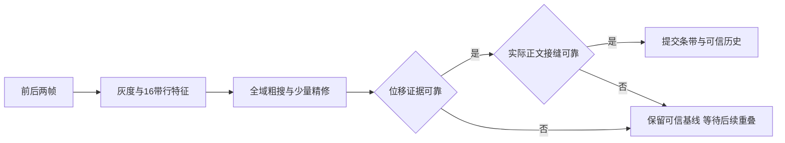

# 长截图算法梳理与开源实现对照

2026-10-24。范围为当前工作区的生产调用，以及 ShareX、eSearch / picture_match、Deepin 官方仓库的固定版本源码。本文是公开研究记录，保留长截图的实现机制、方案取舍和验证边界，供后续开发与对照评测使用。

本次只读源码与已注册的测试，没有修改算法，没有运行竞品，也没有进行同场景成功率、速度或内存基准。检查时主 target 正被其它会话编译占用，因此没有另起 cargo。以下“优势”指实现机制及其预期作用，不是实测排名。

## 判断

- RaiShot 对单轴桌面滚动的可靠性设计有明确价值：多候选比较、局部变化容忍、固定栏辅助匹配、视觉歧义与可信历史分离、实际接缝复核、失败保留可信基线，构成了完整处理链。
- 相比 ShareX 的精确连续行匹配，复杂场景下有明显的机制优势；普通静态页面上，双方都可能正确完成，体验差距未必大。
- 相比 Deepin，优势集中在证据分散采样、多解判别、可信历史和接缝选择。Deepin 已支持上下拼接、固定区域和失败反馈，不能概括成完全没有容错。
- 相比 eSearch，像素位移粒度和应用层拒绝机制是明确差异；eSearch 已使用二维相位相关并支持万向扩展，其二维能力范围更宽，不能说 RaiShot 全面胜出。
- 最值得保留的技术积累是这些规则如何共同约束错误，以及支撑它们的回归样例与调参经验。源码比较尚不能证明“成功率高多少”或“速度快几倍”。

## 先把核心拆成两道题

1. **移动了多少？** 求有符号整数位移 `d`，决定新视口在已有长图中的位置。
2. **从哪里接过去？** 求接缝 `s`，决定旧图保留到哪里、新帧从哪里开始接管。

位移正确，并不保证某条接缝没有穿过变化中的内容。这也是当前实现把定位与接缝验证分开的原因。

无固定栏的例子：帧高 1000px，向下移动 180px。旧帧覆盖正文坐标 0–999，新帧覆盖 180–1179，共有区高 820px。假设选新帧第 600 行作为接缝，它对应旧帧第 780 行：保留旧图 0–780，再接新帧 601–999，成品仍是连续的 0–1179，共 1180 行。接缝可以前后选择，但正确位移下不会因此凭空增减正文。

## 当前生产链路

`long_capture_runtime::Worker::collect → Stitcher::process_shared → choose_alignment → seam_alignment::find_best_offset → moving_seam → 条带提交`。

`stitch_match.rs` 是旧匹配实现，当前 `lib.rs` 没有注册它；不能用它的行哈希逻辑解释正在使用的算法。旧的 `stitch_tests.rs` 也不能直接视为当前已运行的测试证据。

### 1. 统一坐标，并区分完全重复帧

- 一次会话选择纵向或横向；横向通过转置逻辑坐标复用纵向模型。
- 输入尺寸必须相同。灰度为 `(R + 2G + B) / 4` 的整数结果，输出仍保留原始 BGRA 像素。
- 完整 BGRA 相同才在入口跳过，避免稀疏采样漏掉少量文字变化。

入口：`src/stitch.rs`，`src/stitch_stream.rs:120`、`:574`。

### 2. 固定边框提供第二条匹配路径

比较前后帧的同屏坐标，从边缘查找基本不变的区域，估计头、尾及左右边带。四边分别记录整个会话中检测到的最小值，避免一次正文留白被长期当成巨大固定栏。

内容框保留 2px 匹配余量，至少 50×50px，沿滚动轴至少占整帧 70%。检测不到合适内容框就用整帧。启用时，整帧与正文框分别运行对齐；优先可靠且视觉唯一的结果，两者给出冲突位移而分数不足以拉开时判为歧义。

这是运动差异启发式，没有识别网页 DOM 或导航栏语义。失败帧可以更新边框估计，但不会推进最后可信图像、位移历史、视口或输出条带。

入口：`src/stitch_content.rs:23`、`:85`、`:178`；`src/stitch_stream.rs:469`。

### 3. 每行压成 16 个带位置的亮度特征

每行沿跨轴分成最多 16 带，记录每带均值，同时保留整行均值。因此，两行即使总体亮度相同，左右明暗结构不同，仍有机会区分。

再沿滚动轴分 16 段，从每段挑一条显著行：行内明暗跨度大，或与上下行有亮度变化的行优先。它们帮助粗搜看见正文和独特标记，减少均匀采样只落在空白处的情况。

入口：`src/seam_scores.rs:2`、`:42`。

### 4. 全域粗搜，再精修少数候选

- 默认最小重叠 30px，粗搜覆盖 `−(H−30)` 到 `+(H−30)`，包括向上、向下和零位移；这里 H 为本次对齐区域高度，可能是整帧，也可能是裁出的正文框。
- 每个位移取至多 32 条均匀分布的重叠行，再补显著行。
- 每行比较时，16 带中去掉误差最大的 2 带；粗评分取误差较小的 70% 采样行，精评分取较小的 80% 重叠行。
- 同时加回少量全量误差、整行均值差、显著行误差和短重叠惩罚，避免把所有反面证据都丢掉。
- 从全域粗搜选择最多 6 个分离的低谷，各精修 ±2px，再补预测、零位移、正负方向各自最优解，最多 34 个精评候选。

其效果是容忍部分局部变化，同时保留能反驳错误位移的证据。70% / 80% 是评分取样比例，不能解释成“保证容忍 30% / 20% 的任意动态画面”。

入口：`src/seam_alignment.rs:183`；`src/seam_scores.rs:76`、`:106`、`:151`。

### 5. 比较竞争解，限制历史推断

不止挑最低分，还检查有没有相距足够远、视觉上近似同好的其它位移。重复列表可能每隔一行都很像，多个好答案意味着位移仍不确定。

近似等优的判断同时参考分差、错误比例，以及新增错误是否分散在至少三个纵向区间。一个小徽标提供的弱差异，不能轻易把整张周期列表宣称为唯一匹配。

历史取最近最多 5 个同向、视觉唯一的非零位移，以中位数预测；至少两个可信值且波动在 `max(2px, 15%)` 内才算稳定。稳定历史只在视觉近似打平且方向不冲突时辅助选择，不覆盖清楚的视觉赢家。靠预测选中的歧义解不会被再次标成视觉唯一，减少预测自我强化。

入口：`src/seam_alignment.rs:326`、`:375`、`:400`；`src/seam_motion.rs:4`；`src/stitch_stream.rs:282`。

### 6. 用全宽像素差验证位移，并独立验证实际接缝

对最终位移，回到未压缩的灰度图：本次对齐区域（整帧或裁出的正文框）的重叠区，每一行计算该区域全宽的绝对差均值。主要门槛为：无未解歧义、选择分数 ≤8、至少 55% 行差异 ≤15、存在差异 ≤15 的接缝行。这些比例不能解释成整个原始采集帧的全宽匹配比例。

无可信支持时通常要求重叠至少占本次对齐区域高度的 40%。更短重叠要有稳定运动及至少 72% 匹配行，或满足更严格的例外：视觉唯一、重叠全部灰度像素相等、重叠至少 `max(64px, 20%H)`，且最近两个历史都为同向可信结果；H 仍指本次对齐区域高度。

接缝先尝试沿用前次位置：在预测附近找好行，允许最多比全局最低差恶化 2.5；不合适再选全局最低差。提交前 `moving_seam` 再按完整采集宽度检查**实际选中的那一行**，且只允许落在双方共有的滚动正文里。实际行不合格就换另一条可靠行；一条也找不到就拒绝，不准借固定页眉或页脚的相同像素过关。

这里有两个不同关卡：对齐器的全局最佳行存在，不代表预测出来的实际接缝也合格。当前额外复核正是补住这两者之间的空隙。

入口：`src/seam_alignment.rs:70`、`:466`；`src/seam_motion.rs:59`、`:76`；`src/stitch_stream.rs:424`。

### 7. 提交条带，维护视口与最后可信帧

- 向未采集区域前进：从接缝替换旧尾部并追加新条带；反方向超出开头时前插条带。
- 回到已采集范围：只移动视口，不重复增长，也不刷新原有条带。
- 匹配拒绝：保留最后可信帧，下次仍与它比较。恢复必须重新与它产生有效重叠；没有全局长图检索或自动补回缺失内容。
- 新接入条带会复制其像素，边缘裁切也可能复制；生成后的条带通过 `Arc` 共享，避免每帧重建整张长图。克隆会话状态共享像素，导出时才物化整图。元数据和边缘处理仍有开销，不能称为零复制或无限长。
- 拼接器只保留一步撤销。上层运行时先暂存计算结果，再通过会话归属与控制屏障检查后提交，避免迟到帧进入新状态。

入口：`src/stitch_stream.rs:174`、`:240`、`:374`、`:608`；`src/long_capture_runtime.rs:1631`、`:1737`。

### 8. 自动滚动由可信反馈驱动

默认约 16ms 请求采集，生产者与消费者分离，队列最多两帧并有原始像素预算。自动滚动每步发送半格，最多两个未确认半格；新帧确认真实位置并停稳后再继续。拒绝时先停止继续发送，持续不可靠则结束自动滚动并保留结果。旧帧、重复反馈不能确认刚发送的输入。

这使滚动控制与拼接质量形成反馈，帮助保留重叠。它也是可靠性的一部分，单看匹配函数会漏掉这部分价值。手动滚动仍可能超过捕获和匹配吞吐，代码不能保证任何速度都不断档。

入口：`src/long_auto.rs`；`src/long_capture_pipeline.rs`；`src/long_capture_runtime.rs:103`。

## 三套实际对照

| 实现 | 当前匹配与拼接 | 与 RaiShot 的主要差异 | 判断边界 |
| --- | --- | --- | --- |
| ShareX | 受控向下滚动，寻找最长连续完全相同行；排除侧边和底部；无匹配时可沿用历史最佳位置并标记部分成功；重绘整张结果 | RaiShot 有容差、多候选歧义判断、双方向、实际接缝选择、拒绝后基线保留和共享条带 | 对局部动态、重复内容、变步长的预期优势明显；未跑真实对照 |
| Deepin | 固定头尾估计；全宽 50px 灰度模板，归一化相关系数 ≥0.8；上下拼接；50px 羽化；有失败反馈 | RaiShot 使用跨重叠区分散证据和多候选判别，并选择实际接缝；输出保留来源像素，避免羽化混合 | Deepin 已有反向和固定区能力；羽化可能平滑轻微差异，也可能混合两个时刻的文字，具体效果未实测 |
| eSearch / picture_match | 灰度降采样、Hanning、二维 FFT 相位相关取最大峰；固定比例裁边，累计二维偏移并扩展画布 | 当前应用不读 confidence；库没有原分辨率精修和多峰歧义门控。RaiShot 支持 1px 整数位移及更完整的拒绝链 | eSearch 支持万向拼接；相位相关本身是合理方法，不能据此说算法落后 |

一个可量化的实现差异：picture_match 在最大边超过 512 / 1024 / 2048 时使用 2 / 4 / 8 倍降采样，返回整数峰乘回比例。因此 1920×1080 输入的返回位移只能取 4px 的倍数；RaiShot 的位移候选与小步条带支持 1px。**这是位移粒度差异，不等于准确率提高四倍，也不表示 eSearch 每帧都错 4px。**

官方源码依据（固定版本，链接指向完整文件，按函数定位）：

- [ShareX ScrollingCaptureManager.cs](https://github.com/ShareX/ShareX/blob/125dc20dfd2944d95492ce7164f58b5f38ac4b1e/ShareX.ScreenCaptureLib/ScrollingCaptureManager.cs)：`CompareRows` / `CombineImages`，连续精确行匹配、历史位置回退及整图追加。
- [ShareX 默认参数](https://github.com/ShareX/ShareX/blob/125dc20dfd2944d95492ce7164f58b5f38ac4b1e/ShareX.ScreenCaptureLib/ScrollingCaptureOptions.cs)：默认采集等待及滚动配置。
- [Deepin pixmergethread.cpp](https://github.com/linuxdeepin/deepin-screen-recorder/blob/60dd57feea8caad092da41bd14d9ca0d6bffc3cb/src/utils/pixmergethread.cpp)：`getTopFixedHigh`、`getBottomFixedHigh`、`splicePictureUp`、`splicePictureDown`、`blendVerticalSeamBand`。
- [eSearch clip_window.ts](https://github.com/xushengfeng/eSearch/blob/a53f462ef05120855ccc157f2683434786f8a0f1/src/renderer/clip/clip_window.ts)：`longMatch` / `longPutImg`，实际调用 picture_match、忽略 confidence、裁边与二维画布。
- [picture_match 0.1.4 的 Rust 实现](https://github.com/xushengfeng/pic_match/blob/a4a017091462d4ba5a490f1af37a086d4719f773/src/lib.rs)：`phase_correlate`、`compute_confidence`、`find_offset`。相位相关取单个最大峰，降采样后没有全分辨率精修。

## 不能被“很强”掩盖的边界

1. **单轴、同尺寸、整数平移模型。** 同时横纵移动、缩放、旋转、内容重排或弹性变形不在直接求解范围内。
2. **有限候选和特征降维。** 灰度丢失颜色，16带均值丢失带内排列；最多34个精评候选存在漏掉正确解或竞争解的可能。最终全宽 SAD 只检查选中位移，“视觉唯一”不是数学证明。
3. **周期内容存在信息不足。** 完全重复的行本就可能无法判断真实位移。当前价值在于拒绝危险推断和限制历史使用，不能保证所有重复列表都可恢复。
4. **动态接缝仍为直线。** 单行全宽均值可能稀释局部变化：占宽5%的黑白变化，平均灰度差仅12.75，低于15阈值。公式说明存在漏过局部变化的可能，本次未运行构造场景验证最终接受行为；没有对象级或二维曲线避缝。
5. **回访不刷新，缺失不补画。** 已保存区域的懒加载或动态更新不会因回访自动替换；跳过一整屏导致完全无重叠时，需要回到可信帧附近重新取得重叠。
6. **固定栏是启发式。** 检测依靠同屏位置变化和会话最小值；固定栏大小变化、边缘动画、很大的固定区域都可能削弱效果。辅助正文框还受70%高度限制。
7. **容量有实际限制。** 总量3200万像素、任一边65535px，取先到者。宽1920时理论长轴约16666px；宽3840时约8333px，不能只引用65535宣称任意宽度都能截到该长度。
8. **保守拒绝有完成率代价。** 少误拼和更高一次完成率是不同指标。拒绝很多帧可以保护结果，也可能要求用户放慢或回滚；比较必须同时统计两者。

## 当前测试能说明什么

本次检查的是已接入当前模块的测试源码，未执行，不能写成本轮通过：

- `seam_alignment_tests.rs`：同均值不同空间纹理、固定栏、均匀列表、周期歧义、历史不能覆盖明确赢家、小徽标与强锚点、最多34候选、短重叠门控。
- `stitch_regression_tests.rs`：小步大重叠、多帧变步加速、无重叠与坏帧拒绝后恢复和撤销、文字抗锯齿变化；另有需外部PNG且默认忽略的可选真实样本。
- `stitch_stream_tests.rs`：横纵与正反方向、1px小步、固定栏、回访去重、共享条带像素、内存边界、一步撤销。
- `stitch_dynamic_seam_tests.rs`：实际预测缝不可靠时重新选缝、不能用固定栏蒙混、拒绝不改变已提交状态、双轴双方向的真实条带输出与撤销。
- `long_auto_pacer_tests.rs` 与 `long_capture_pipeline_tests.rs`：新帧确认、拒绝背压、队列和控制屏障等模型合同。

这些回归体现了长期优化覆盖的问题，但合成测试、PNG裁片和真实应用滚动是不同证据。当前源码已有的测试覆盖不能替代跨软件同条件对照。

## 若进一步量化，最小有用对照

先用相同输入帧序列隔离匹配质量，再用实际应用测试采集与自动滚动闭环。场景至少覆盖普通静态文字、重复列表、窄正文大留白、固定头尾、局部动态、变步与短重叠、反向回访、无重叠后恢复；二维运动另列能力项。

每类同时记录：成品是否完整、漏行/重复行数量、静默误拼率、拒绝率与需要回滚次数、恢复后是否保留正确像素；性能另记每帧延迟和峰值内存。完成率与静默误拼分开，才能量化“可靠性更强”究竟给用户带来多大收益。
